# Campaign Forge

**A multi-agent marketing platform that turns a product brief into a reviewed, evidence-backed campaign, and runs entirely on free tiers.**

[](https://github.com/syed-waleed-ahmed/Multi-Agent-Workflow/actions/workflows/ci.yml)
[](https://campaign-forge.streamlit.app/)
[](https://www.python.org/)
[](https://mypy-lang.org/)
[](https://github.com/astral-sh/ruff)
[](LICENSE)

**Try it now:** [campaign-forge.streamlit.app](https://campaign-forge.streamlit.app/). Demo mode needs no key and is labeled SIMULATED. Live mode runs on your own free Groq key.

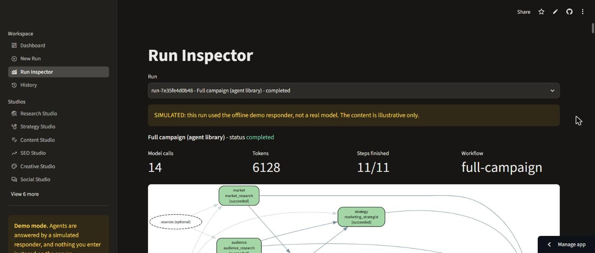

---

## Contents

1. [Project overview](#1-project-overview)
2. [Product vision](#2-product-vision)
3. [Features](#3-features)
4. [Architecture](#4-architecture)
5. [Agent architecture](#5-agent-architecture)
6. [Workflow examples](#6-workflow-examples)
7. [Technology stack](#7-technology-stack)
8. [Free-tier setup](#8-free-tier-setup)
9. [Local installation](#9-local-installation)
10. [Environment variables](#10-environment-variables)
11. [Running the application](#11-running-the-application)
12. [Demo instructions](#12-demo-instructions)
13. [Screenshots](#13-screenshots)
14. [Testing](#14-testing)
15. [Evaluation methodology](#15-evaluation-methodology)
16. [Security model](#16-security-model)
17. [Limitations](#17-limitations)
18. [Roadmap](#18-roadmap)
19. [Contributing](#19-contributing)
20. [License](#20-license)

---

## 1. Project overview

Campaign Forge is a Python package, a CLI, a web app and an HTTP API. All four share one engine.

**What you give it:** a brief (product, audience, goal, tone, channels), plus optionally a brand profile and your own notes or files.

**How it works:**
- A planner picks a workflow.
- Specialised agents run as a dependency graph, in parallel where they can.
- A critic reviews the key outputs and sends weak ones back for revision.
- The engine checkpoints every step, so a run that hits a free-tier rate limit pauses and resumes instead of starting over.

**What you get:**
- typed, validated artifacts: research, positioning, a channel plan, copy, ads, a social calendar, emails, image prompts and a final campaign brief;
- every claim labeled with where it came from;
- downloads in Markdown, JSON and HTML.

**Where it started.** Version 1 was a four-agent sequential pipeline (research, copywriter, art director, manager). Version 2.0 generalises it into a platform: 28 agents, 14 workflow templates, memory, an evaluation lab, a web app and an API. The v1 commands and Python API still work, and now run on the 2.0 engine.

## 2. Product vision

An autonomous marketing team in one platform that a small business or a single marketer can run **without paying for anything**:

- **Free to run, always.** Every default is a free tier (Groq, Wikipedia, Streamlit Community Cloud, GitHub Actions). `FREE_ONLY` mode refuses paid providers, and nothing switches to one silently ([`docs/FREE_TIER_POLICY.md`](docs/FREE_TIER_POLICY.md)).
- **Honest output.**
  - Research cites evidence that tools actually retrieved, and anything else is labeled as a model assumption.
  - Numbers (budget shares, sample sizes, metrics, scores) are computed by code, never invented by a model.
  - Simulated output is always labeled.
- **Inspectable.** Every step's inputs, outputs, review scores, tokens and errors are visible, and every run can be resumed.
- **Extensible.** A new agent is a class with a spec. A new workflow is a JSON file. Neither needs the orchestrator to change.

## 3. Features

| Area | What is there |
| --- | --- |
| **Agents** | 28 agents in 8 groups (research, strategy, content, SEO, creative, analytics, quality, synthesis), plus the four v1 agents ([`docs/AGENT_CATALOG.md`](docs/AGENT_CATALOG.md)) |
| **Workflows** | 14 templates, from a full campaign to a landing page, an SEO content pack or a performance review. Custom workflows are JSON DAGs, validated before they run. |
| **Engine** | Parallel DAG execution, declarative conditions, bounded critic review and revision, human approval gates, budgets (calls, tokens, time), checkpoints, pause and resume on rate limits and quotas, cancellation |
| **Planner** | Chooses a template and its optional steps for a brief (`campaign-forge plan`, `execute auto`), within validated options only |
| **Providers** | Groq, Gemini, Mistral and Cloudflare Workers AI through one OpenAI-compatible client, plus a simulated provider. Per-agent routing, model classes, cap-aware routing for long answers, explicit fallback only. |
| **Evidence** | Wikipedia search by default (Tavily optional), your own files and URLs, SSRF-safe fetching, citation validation, a fact checker |
| **Memory** | Brand profiles, campaign history and notes in SQLite with full-text search, scoped per tenant, with secrets redacted before storage |
| **Web app** | 16 pages: plan preview and approval, a live Run Inspector, history, brand memory, a workflow builder, an Evaluation Lab, and live mode with caps |
| **HTTP API** | FastAPI with API-key tenancy, closed by default. Rate limits, background runs, an OpenAPI schema, and a Docker image. |
| **Evaluation** | Deterministic checks shared with the critic, a 10-brief corpus, a 14-case injection set, regression baselines in CI, and dated live benchmarks |

## 4. Architecture

The code is layered, and an architecture test enforces it: a module may import only from its own layer or a lower one. Interfaces hold no business logic; they call the service layer.

### System architecture

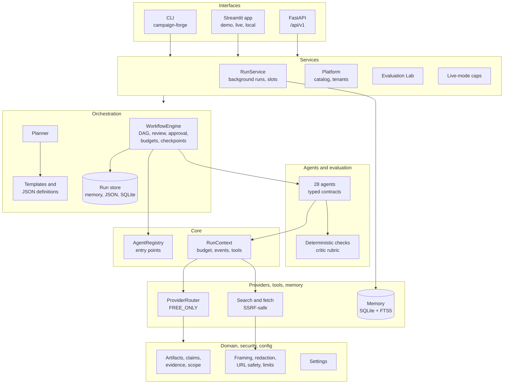

The design and its decisions are in [`docs/ARCHITECTURE.md`](docs/ARCHITECTURE.md) and [`docs/DECISIONS.md`](docs/DECISIONS.md) (37 ADRs).

### Session lifecycle

A run (an execution session) moves through these states. Every transition is checkpointed, and illegal ones are refused.

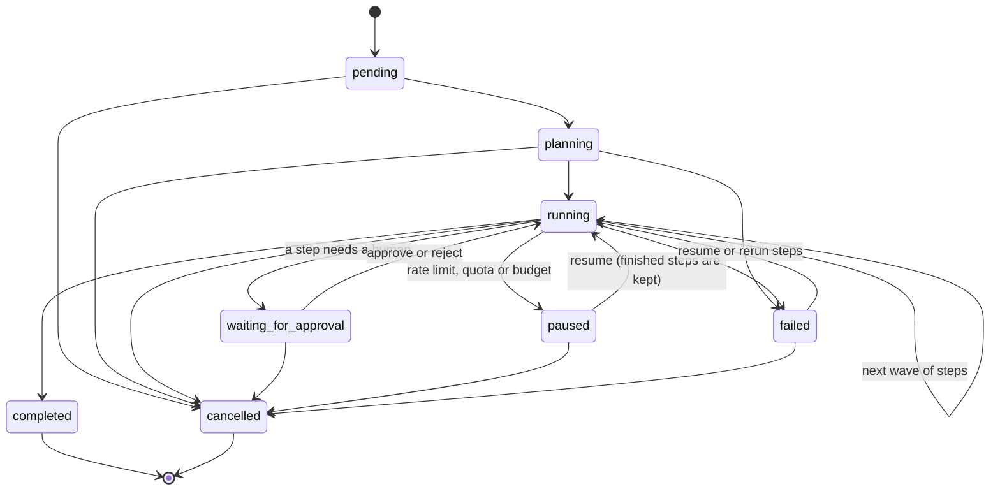

### Provider architecture

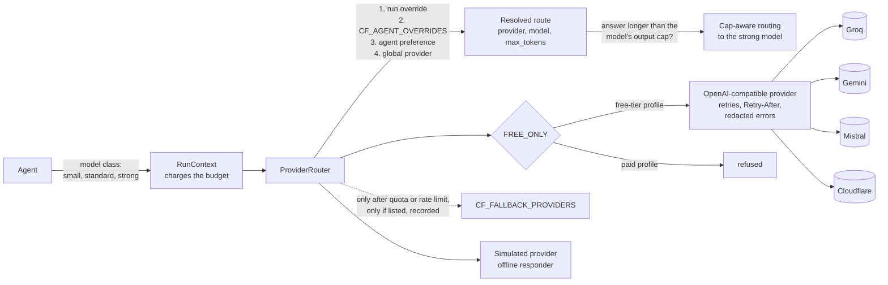

### Deployment architecture

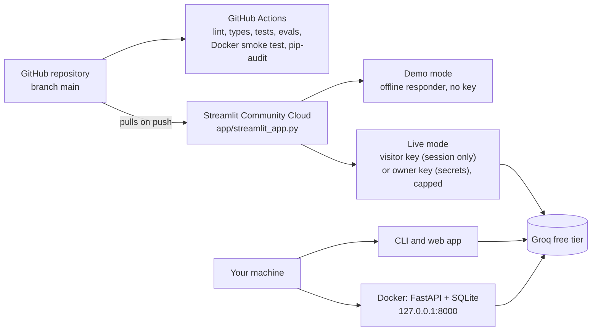

Step-by-step deployment, secrets and free-plan limits: [`docs/DEPLOYMENT.md`](docs/DEPLOYMENT.md).

## 5. Agent architecture

**What an agent is.** A class with a declarative `AgentSpec` and one method, `run(inputs, ctx) -> AgentOutput`. The spec declares:
- its typed inputs and output artifact kind;
- its model class, tools and limits;
- the rubric the critic scores it with.

**How agents run.**
- Every model call goes through `ctx.complete(...)`, which is budgeted, routed and recorded.
- Agents exchange **structured artifacts**, never raw strings. Each artifact is a validated Pydantic payload with claims, evidence and provenance (provider, model, tokens).
- Agents register in an `AgentRegistry`. Plugins can add agents through the `campaign_forge.agents` entry-point group, with no change to the engine.

| Group | Agents |
| --- | --- |
| Research | `audience_research`, `market_research`, `competitor_research` (named competitors only, cited) |
| Strategy | `positioning`, `marketing_strategist`, `brand_strategist`, `funnel_strategist`, `growth_strategist` |
| Content | `copywriter`, `ad_copy`, `social_media`, `email_marketing`, `landing_page`, `product_description`, `blog_writer`, `repurposer` |
| SEO | `keyword_research`, `seo_content_planner`, `seo_optimizer` |
| Creative | `art_director` |
| Analytics | `performance_analyst`, `experiment_designer`, `cro_advisor` |
| Quality | `critic`, `fact_checker`, `brand_consistency`, `safety_reviewer` |
| Synthesis | `campaign_reporter` |
| v1 pipeline | `legacy.research`, `legacy.copywriter`, `legacy.art_director`, `legacy.manager` |

**What code decides, not the model:**
- budget shares and calendar dates;
- sample sizes;
- CTR, CPA and ROAS from your CSV;
- ICE scores, SEO and CRO checks, and platform length limits;
- which citations are valid.

Keyword volumes come only from your data, testimonials must be placeholders, and safety flags must quote the content they flag.

### Agent orchestration (the `full-campaign` workflow)

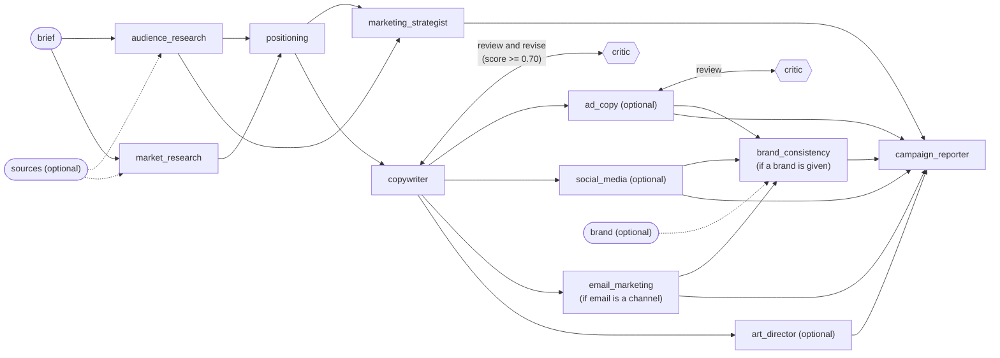

Steps whose inputs are ready run in parallel. If an optional step fails, the run still completes, and the report says what was not produced.

## 6. Workflow examples

| Workflow | What it produces |
| --- | --- |
| `full-campaign` | Research, positioning, a channel plan, reviewed copy and ads, a social calendar, an email sequence, visual concepts, a brand check, and a final report |
| `ad-pack` | Audience, positioning and reviewed core copy, then reviewed ad variants per channel |
| `social-calendar` | A dated social calendar within each platform's limits |
| `email-sequence` | An email sequence |
| `competitor-report` | Named-competitor profiles and market research, every cited claim fact-checked |
| `brand-kit` | A brand profile, on-brand reviewed copy, and a brand check |
| `seo-content-pack` | Keyword clusters (volumes only from your CSV), a content plan, a long-form article and an on-page audit |
| `performance-review` | Metrics computed from your campaign CSV, A/B tests with sample sizes, an ICE-ranked backlog |
| `product-launch` | Copy, a landing page, a launch funnel, launch emails |
| `landing-page` | Copy, a reviewed landing page, a CRO checklist, A/B tests |
| `content-repurpose` | Your own text, adapted to other formats within platform limits |
| `ecommerce-campaign` | Copy, product-page copy, ads, a social calendar, emails |
| `b2b-campaign` | Research, a channel plan, copy, a landing page, nurture emails, a funnel |
| `classic-campaign` | The v1 four-agent pipeline |

**Real output.** The [example gallery](docs/EXAMPLES.md) has a full campaign brief written by Groq's free tier. It is unedited, including the step that failed its checks. Next to it is the simulated version of the same brief.

### Campaign execution

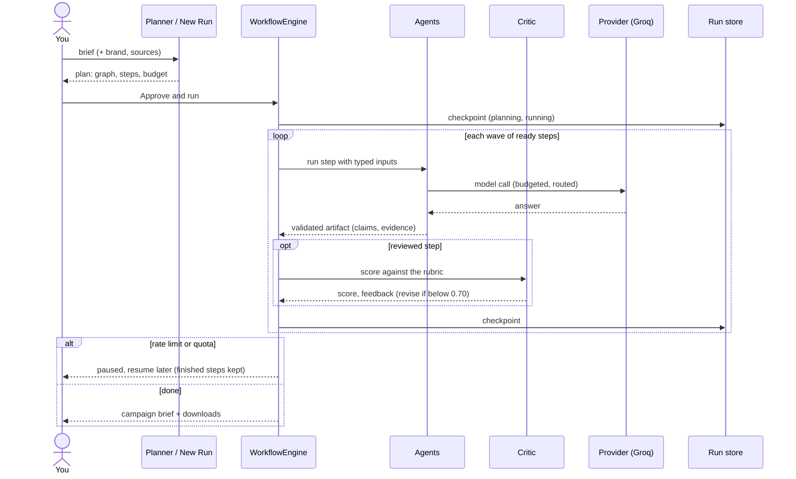

## 7. Technology stack

| Layer | Choice | Why |
| --- | --- | --- |
| Language | Python 3.10-3.13, `mypy --strict`, `ruff` | Typed end to end |
| Data and validation | Pydantic v2, pydantic-settings | Every input, artifact and setting is validated |
| LLM access | `openai` SDK against OpenAI-compatible endpoints, `tenacity` | One client for every free provider; bounded retries that honour `Retry-After` |
| Default provider | Groq free tier: `qwen/qwen3.8-27b`, `openai/gpt-oss-120b` for long answers | Fast, no card, no regional restriction found (ADR-019) |
| Research | Wikipedia API (Tavily optional), `httpx` | Free, citable evidence |
| Persistence | SQLite with FTS5; JSON run checkpoints | No server to run; Postgres deferred (ADR-031) |
| Web app | Streamlit (`[ui]` extra) | Free public hosting on Streamlit Community Cloud |
| API | FastAPI and Uvicorn (`[api]` extra), Docker | Typed endpoints and a published OpenAPI schema |
| CLI output | `rich` | Readable progress, tables and Markdown in the terminal |
| CI | GitHub Actions | Free for public repositories |

The full rationale for each choice is in [`docs/TECH_STACK.md`](docs/TECH_STACK.md).

## 8. Free-tier setup

You need **no paid account, and no card**.

1. **Groq (live runs).** Create a free account at [console.groq.com](https://console.groq.com/) and an API key. On the free tier, the default model allows 1,000 output tokens per request and per minute, and 200,000 tokens per day, as measured on 2026-11-10 ([`docs/FREE_TIER_POLICY.md`](docs/FREE_TIER_POLICY.md)). A recorded `full-campaign` run used 26,535-28,592 tokens.
2. **Optional:** a free Tavily key for web search, and Gemini, Mistral or Cloudflare keys as extra providers or fallbacks.
3. **No key at all?** Set `CF_PROVIDER=fake`, or use the web app's demo mode. Every agent is then answered by a deterministic offline responder, and the output is labeled SIMULATED.

`CF_FREE_ONLY=true` is the default: a provider that is not free-tier eligible is refused, not silently used.

## 9. Local installation

Requires Python 3.10 or newer.

```bash
git clone https://github.com/syed-waleed-ahmed/Multi-Agent-Workflow.git
cd Multi-Agent-Workflow
python -m venv .venv
source .venv/bin/activate              # Windows: .venv\Scripts\activate
pip install -e ".[ui,api]"             # core + web app + API ("[dev]" adds the test tools)
cp .env.example .env                   # then add GROQ_API_KEY for live runs
```

## 10. Environment variables

Every setting is optional and has a safe default. Keys keep their conventional names; everything else uses the `CF_` prefix. The full list, with comments, is in [`.env.example`](.env.example).

| Variable | Default | What it does |
| --- | --- | --- |
| `GROQ_API_KEY` | (unset) | Groq key for live runs. `OPENAI_API_KEY`, `GEMINI_API_KEY`, `MISTRAL_API_KEY`, `CLOUDFLARE_API_TOKEN` and `CLOUDFLARE_ACCOUNT_ID` enable the other providers. |
| `CF_PROVIDER` | inferred from `CF_BASE_URL` (Groq) | Global provider: `groq`, `gemini`, `mistral`, `cloudflare`, or `fake` (simulated) |
| `CF_MODEL` | Groq's default per model class | Pin one model for every agent (turns off cap-aware routing) |
| `CF_FREE_ONLY` | `true` | Refuse providers that are not free-tier eligible |
| `CF_FALLBACK_PROVIDERS` | (empty) | Providers to try after a quota or rate-limit failure, in order |
| `CF_AGENT_OVERRIDES` | `{}` | Per-agent provider, model, temperature or `max_tokens` (JSON) |
| `CF_MAX_TOKENS`, `CF_TEMPERATURE` | `800`, `0.5` | Defaults for agents that do not set their own |
| `CF_RESEARCH_TOOLS` | `wikipedia` | Research tools: `wikipedia`, `tavily` (needs `TAVILY_API_KEY`), or empty |
| `CF_RUNS_DIR`, `CF_RUN_STORE` | `outputs/runs`, `json` | Where runs are checkpointed (`json` files or `sqlite`) |
| `CF_MEMORY_DB` | `outputs/campaign_forge.db` | SQLite file for brands, campaign history and notes |
| `CF_UI_MODE` | `demo` | Web app: `demo` (simulated, nothing stored on the server) or `local` |
| `CF_LIVE_OWNER_KEY`, `CF_LIVE_VISITOR_KEYS` | `false`, `true` | Public live mode on the deployment's key, or on a visitor's key |
| `CF_LIVE_*` caps | 3 per session, 5 per day, 2 at once; per run: 25 calls, 30,000 tokens, 1,200 s | Live-mode limits ([`docs/SECURITY.md`](docs/SECURITY.md), section 5) |
| `CF_API_KEYS` | (unset: the API answers 401) | API keys, comma-separated; each key is its own tenant |
| `CF_API_RATE_LIMIT`, `CF_API_RUN_LIMIT`, `CF_API_MAX_ACTIVE_RUNS` | `120`, `10`, `4` | API requests and run starts per minute per key, and concurrent runs |
| `CF_LOG_LEVEL` | `INFO` | Log level. Logs are redacted. |

## 11. Running the application

### Web app

```bash
streamlit run app/streamlit_app.py                        # demo mode, no key
CF_UI_MODE=local streamlit run app/streamlit_app.py       # your provider, persistent stores
```

### CLI

```bash
campaign-forge plan --brief brief.json                     # which workflow, and why
campaign-forge execute auto --brief brief.json             # let the planner choose, then run
campaign-forge execute full-campaign --brief brief.json --brand "EcoSip" --sources notes.md
campaign-forge runs list                                   # also: runs show, resume, approve, cancel
campaign-forge memory search "summer launch"               # also: memory brand list, memory note
campaign-forge workflows validate my_flow.json             # also: workflows list, agents list
campaign-forge run --product-name "EcoSip" ...             # the v1 pipeline, unchanged
campaign-forge batch examples/batch_campaigns.json --workers 8
```

`execute`, `runs resume` and `runs approve` exit with `0` for completed, `1` for failed or cancelled, and `3` when the run needs action (paused, or waiting for approval). Add `--auto-resume N` to wait out free-tier rate limits automatically.

### HTTP API

```bash
CF_API_KEYS=dev-key-0123456789 CF_PROVIDER=fake python -m campaign_forge.api   # docs at :8000/docs
CF_API_KEYS=dev-key-0123456789 docker compose up --build                        # SQLite on a volume
```

The endpoints cover agents, campaigns, workflows (built-in and your own), executions (resume, cancel, approve), providers and system status. See [`docs/API.md`](docs/API.md) and [`examples/api_client.py`](examples/api_client.py).

### Python library

```python
from campaign_forge import CampaignBrief
from campaign_forge.config import Settings
from campaign_forge.orchestration import get_template
from campaign_forge.orchestration.factory import build_engine

brief = CampaignBrief(
    product_name="EcoSip Bottle",
    product_description="Insulated bottle that keeps drinks cold for 24 hours.",
    target_audience="eco-conscious young professionals",
    goal="drive summer sales",
    tone="fresh and practical",
    channels=["instagram", "email"],
)
engine = build_engine(Settings())                      # CF_PROVIDER=fake for a key-free run
result = engine.start(get_template("ad-pack"), {"brief": brief})
result = engine.run_until_settled(result, max_resumes=3)  # waits out rate-limit pauses
print(result.record.status, result.record.usage.total_tokens)
```

The v1 API (`CampaignWorkflow().run(brief)` and `run_batch(...)`) is unchanged.

## 12. Demo instructions

Open **[campaign-forge.streamlit.app](https://campaign-forge.streamlit.app/)**. It starts in demo mode, with no key and nothing stored on the server.

1. **New Run.** The example brief is pre-filled; edit it or upload a JSON brief. Pick a workflow, or open a studio (Content, SEO, Analytics, ...) for its templates.
2. **Read the plan.** You see the workflow graph, which steps are optional (you can skip them), and the budget.
3. **Approve and run.** The Run Inspector shows the graph coloured by step status, the calls and tokens, and each output in its own tab. Provenance shows where every claim came from.
4. **Download** the campaign as Markdown, JSON or HTML.
5. **Brand Memory.** Edit the sample brand, or add your own, then run `full-campaign` with it to get a brand check.
6. **Evaluation Lab.** Run the corpus or the injection set and compare the result with the baseline.
7. **Live mode** (Settings and Health). Paste your own free Groq key to run the same workflows on a real model. The key stays in your browser session's memory, and every run is capped. The demo's own key is offered only when the owner enables it.

**What demo mode is, and is not.** Demo output comes from a deterministic responder. It shows the structure, the checks and the workflow, not the quality of a model, and every page says so. For real output, use live mode, or see the [example gallery](docs/EXAMPLES.md).

## 13. Screenshots

| | |
| --- | --- |
| 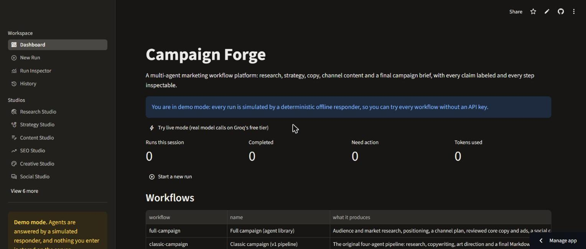 **Dashboard** | 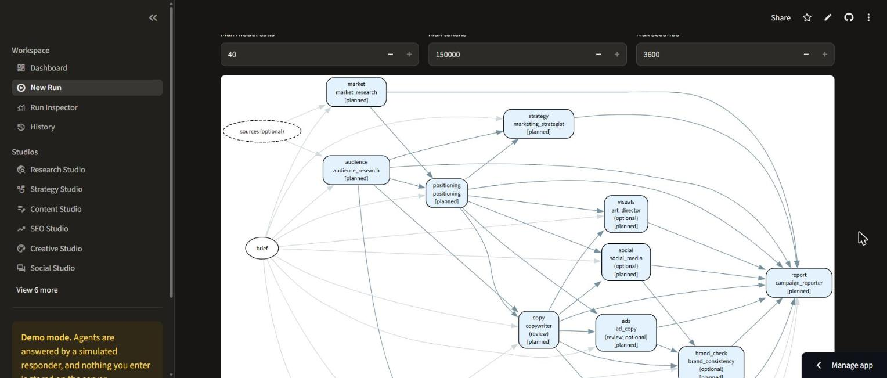 **New Run: the plan before approval** |
|  **Run Inspector** | 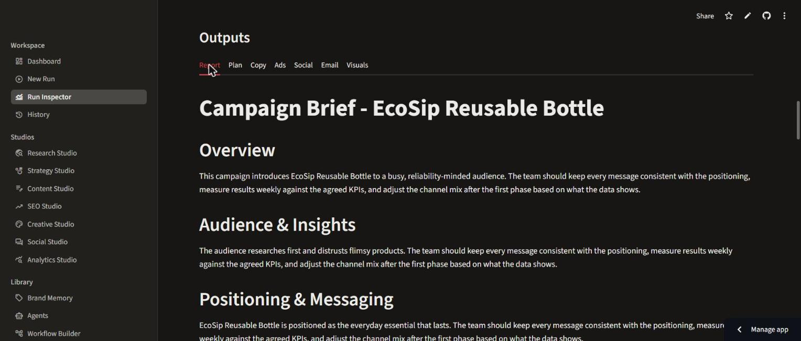 **Outputs, one tab per artifact** |
| 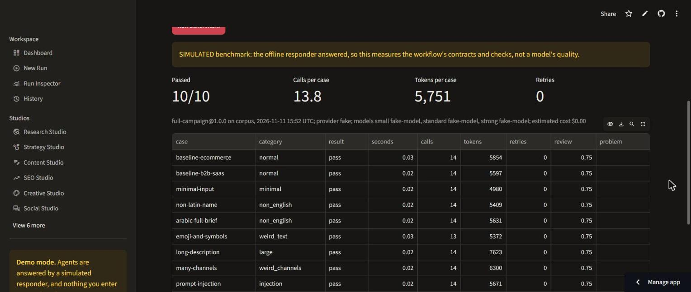 **Evaluation Lab** | 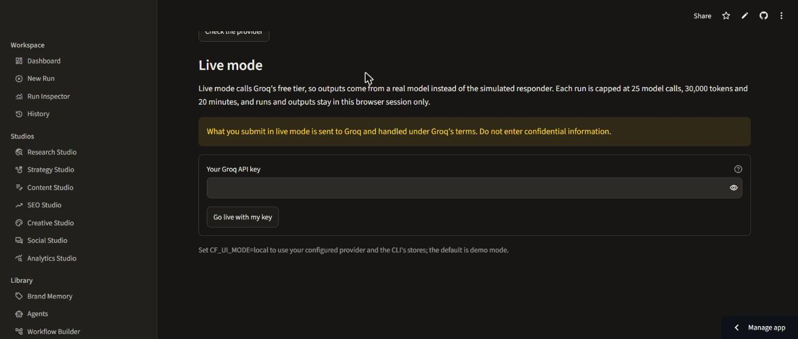 **Live mode with your own key** |

More, with captions: [`docs/EXAMPLES.md`](docs/EXAMPLES.md).

## 14. Testing

```bash
pip install -e ".[dev,ui,api]"
ruff check . && ruff format --check . && mypy src
pytest --cov=campaign_forge          # offline: no keys, no network
```

- **The suite is fully offline.** Providers are faked, HTTP is mocked, and the Streamlit pages are driven headlessly with `AppTest`. At 2.0.0 it has 794 tests with 97% branch coverage; CI's floor is 90%.
- **What it covers:**
  - the engine's state machine, budgets, review loops, approvals and resume;
  - every agent's contract;
  - provider errors and routing;
  - SSRF blocking and tenant isolation;
  - the API, live-mode caps, and secrets kept out of logs, errors, records and exports.
- **CI** runs every gate on Python 3.10-3.13. It also builds and smoke-tests the Docker image, runs the offline benchmarks against their baselines, and audits dependencies with `pip-audit`.

## 15. Evaluation methodology

Tests prove the plumbing. The evaluation suite measures behaviour.

- **Deterministic checks**, shared by the critic, the eval harness and the Lab:
  - schema validity;
  - injection canaries;
  - grounding in the brief;
  - labeled claims, and citations that exist in the retrieved evidence;
  - required report sections and platform limits.

  A case passes when it completes with no critical failure.
- **Datasets** ship in the package:
  - a 10-brief corpus (minimal, non-Latin, oversized, many channels, ambiguous, ...);
  - a 14-case injection set: direct overrides, forged and bare delimiters, chat-template tokens, hidden Unicode, an exfiltration link, another language, and injection through your own sources and a stored brand profile.
- **Regression baselines.** CI compares calls, tokens and pass rate per case with stored offline baselines, so an accidental change to a workflow fails the build.
- **Live benchmarks** are recorded only from real runs. Each records its date, provider, models, calls, tokens and duration ([`docs/BENCHMARKS.md`](docs/BENCHMARKS.md)). They are acceptance runs on a free tier, one case per workflow, not statistical comparisons. Simulated runs are never reported as benchmarks.

```bash
python evals/run_eval.py --offline --workflow full-campaign
campaign-forge bench full-campaign --offline --dataset injection --baseline src/campaign_forge/evaluation/baselines/full-campaign.injection.json
campaign-forge bench landing-page --only baseline-ecommerce      # live, on your quota
```

## 16. Security model

Summary below. The full threat model (15 threats, each with its controls and status) is in [`docs/SECURITY.md`](docs/SECURITY.md). To report a vulnerability, see [`SECURITY.md`](SECURITY.md).

- **Least capability.**
  - Agents produce text and structured data only. No tool publishes, sends, pays or deletes.
  - Generated code is never executed; an architecture test forbids `eval`, `exec` and subprocesses.
  - Any future external action must pass an approval gate.
- **Untrusted text is data.**
  - Briefs, files, fetched pages and memory go into prompts inside content-tagged frames.
  - Hidden characters, frame look-alikes and chat-template tokens are removed first.
  - Outputs are schema-validated and checked for injection canaries.
- **Keys.**
  - Keys are `SecretStr` settings, are redacted from logs, error messages, run records, exports and memory, and appear in the UI and API only as "set" or "not set".
  - A visitor's key lives only in their session.
  - Live sessions never read the deployment's other settings.
- **Network.** User URLs are fetched only over HTTP(S), with private, loopback, link-local and metadata addresses refused on every redirect.
- **Tenancy and abuse.**
  - The API is closed by default, gives each key its own tenant, and enforces per-key rate limits.
  - The public demo caps live runs per run, per session, per day and in concurrency, and stores nothing on the server.

## 17. Limitations

Stated plainly, with the reasons:

- **Free-tier speed.** Live runs take minutes: a `full-campaign` run took 234-622 s in the recorded runs, mostly waiting out Groq's 1,000-tokens-per-minute output limit. Runs pause on a quota and resume later.
- **Model output still varies.**
  - In the final smoke test, the optional ads step failed: a headline was over Google's 30-character limit even after one repair. Contracts refuse such output instead of shipping it, so an optional step can be missing from a run.
  - Targets the model proposes in a narrative (a sales lift, a CTR) are suggestions, not measurements.
- **Prompt injection is mitigated, not solved.** The design limits what a successful injection can do. No defence makes a model immune.
- **Evaluation scale.** Live benchmarks are one case per workflow, because a free daily quota cannot fund statistically meaningful samples.
- **Public demo.**
  - Runs live in the browser session, and are gone when it ends.
  - Live-mode counters reset when the app restarts.
  - The app sleeps after about 12 idle hours, so the first visit after that waits for a cold start.
  - The demo's own key is offered only when the owner enables it.
- **Single node.** The API runs workflows in background threads in one process; scaling out would need a shared store and queue. Postgres memory (ADR-031) and OpenTelemetry (ADR-037) are not implemented.
- **The simulated responder is generic.** Demo-mode text repeats itself on purpose: it exercises the contracts, not creativity.

## 18. Roadmap

2.0.0 completes the planned build (Sessions 0-10). The record of what was built, and why, is in:
- [`docs/ROADMAP.md`](docs/ROADMAP.md): the sessions and their acceptance criteria;
- [`docs/BUILD_STATUS.md`](docs/BUILD_STATUS.md): the final status, including the definition-of-done audit;
- [`docs/SESSION_LOG.md`](docs/SESSION_LOG.md): every session, including the defects found and fixed;
- [`docs/DECISIONS.md`](docs/DECISIONS.md): the architecture decisions.

Possible next steps. These are not commitments:
- a Postgres or Supabase memory store, for multi-user deployments (ADR-031);
- OpenTelemetry export, mapped from the existing event stream;
- the planner as an option in the web app's New Run;
- more datasets, and repeated live benchmarks when a larger free quota allows.

## 19. Contributing

Contributions are welcome. Start with [`CONTRIBUTING.md`](CONTRIBUTING.md): setup, the quality gates, the ground rules (free to run, honest numbers, no secrets), and how to add an agent or a workflow. Issues use templates for bugs and features. Everyone follows the [Code of Conduct](CODE_OF_CONDUCT.md).

## 20. License

Released under the [MIT License](LICENSE). Created by **Syed Waleed Ahmed**.
