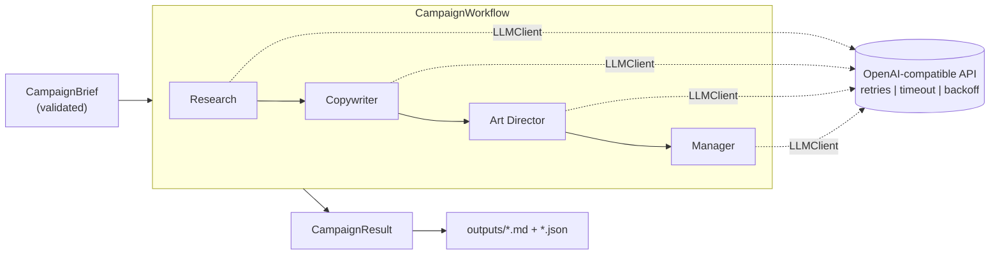

# Campaign Forge

**A production-grade, multi-agent workflow that turns a one-line product brief into a complete, ready-to-hand-off marketing campaign.**

[](https://www.python.org/)
[](https://github.com/astral-sh/ruff)
[](http://mypy-lang.org/)
[](#testing)
[](LICENSE)

Campaign Forge coordinates four specialised AI agents, each owning one stage of the pipeline, exactly like a real marketing team:

| Agent | Responsibility | Output |
| --- | --- | --- |
| Research | Audience insights, pain points, trends, positioning angles | Markdown summary |
| Copywriter | Tagline, primary message, headlines, body copy, CTA | Validated structured JSON |
| Art Director | 3-5 image-generation prompts (DALL-E / Stable Diffusion) | List of prompts |
| Manager | Synthesises everything into a polished campaign brief | Markdown document |

It runs on any **OpenAI-compatible** endpoint and defaults to [Groq](https://groq.com) (fast, free-tier friendly).

> This started as a learning exercise and was re-engineered into a small, dependency-light standalone application you can drop into a larger system: typed models, validated I/O, resilient API calls, concurrent batch processing, a real CLI, and a full test suite. See [`docs/ARCHITECTURE.md`](docs/ARCHITECTURE.md) for the high-level design.

---

## Table of contents

- [Campaign Forge](#campaign-forge)
  - [Table of contents](#table-of-contents)
  - [Why it is production-ready](#why-it-is-production-ready)
  - [Architecture](#architecture)
  - [Project structure](#project-structure)
  - [Installation](#installation)
  - [Configuration](#configuration)
  - [Usage](#usage)
    - [Single campaign (interactive)](#single-campaign-interactive)
    - [Single campaign (flags)](#single-campaign-flags)
    - [Batch mode (concurrent)](#batch-mode-concurrent)
    - [As a library](#as-a-library)
  - [Output](#output)
  - [Development](#development)
  - [Testing](#testing)
  - [Evaluation](#evaluation)
  - [Security](#security)
  - [Roadmap](#roadmap)
  - [Contributing](#contributing)
  - [License](#license)
  - [Author](#author)

---

## Why it is production-ready

- **Multi-agent orchestration** built on a shared `BaseAgent` abstraction, so adding or swapping a stage is a small, local change.
- **Built for scale.** `run_batch()` fans many briefs across a thread pool with **per-item error isolation**: one failing brief never aborts the batch, and results are returned in input order.
- **Resilient by default.** Automatic retries with exponential backoff and jitter on transient API errors (rate limits, timeouts, 5xx), a hard per-request timeout, and fast-fail on permanent errors. The backoff also honours a server `Retry-After` hint. Truncated responses (cut off at the token limit) fail loudly instead of shipping a partial brief, and the copywriter self-repairs a malformed JSON response by re-asking once with the error fed back.
- **Typed and validated end-to-end.** [Pydantic](https://docs.pydantic.dev/) models validate every input and every structured model output; fields are length-bounded so oversized input is rejected at the boundary rather than inflating cost or propagating downstream.
- **Measured, not just mocked.** Beyond the offline unit suite, an [evaluation harness](#evaluation) runs a diverse, adversarial brief corpus end-to-end and scores completion, grounding, and prompt-injection resistance - so real-world behaviour is a tracked number, not a guess.
- **Import-safe.** No side effects at import time, so the package is safe to embed as a library. Configuration is lazy and comes from environment variables or a `.env` file.
- **Fully typed and linted.** `mypy --strict` and `ruff` pass cleanly; the package ships a `py.typed` marker.
- **Tested without a network.** The suite is fully mocked (no API key, no calls) and covers retries, batch isolation, output validation, and the CLI. Continuous integration runs the same gates on Python 3.10-3.13.

---

## Architecture



Each agent transforms the accumulated context and passes it to the next. Every model call goes through a single `LLMClient` that centralises resilience and logging. The full high-level design - components, data flow, concurrency model, resilience strategy, and extension points - is documented in [`docs/ARCHITECTURE.md`](docs/ARCHITECTURE.md).

---

## Project structure

```text
multi_agent_workflow/
  main.py                      # backwards-compatible entry point (delegates to CLI)
  pyproject.toml               # packaging, dependencies, tool configuration
  examples/batch_campaigns.json
  docs/ARCHITECTURE.md         # high-level design
  src/campaign_forge/
    cli.py                     # argparse CLI: `run` and `batch` subcommands
    config.py                  # pydantic-settings configuration (env / .env driven)
    models.py                  # CampaignBrief, CopyContent, CampaignResult
    llm.py                     # resilient LLM client (retries, timeout, backoff)
    parsing.py                 # lenient JSON / list recovery from raw model text
    workflow.py                # CampaignWorkflow.run() + concurrent run_batch()
    loaders.py                 # load and validate briefs from JSON
    logging_config.py          # structured logging to stderr
    exceptions.py              # typed exception hierarchy
    agents/
      base.py                  # BaseAgent abstraction
      research.py  copywriter.py  art_director.py  manager.py
  tests/                       # fully mocked pytest suite
  evals/                       # real-model evaluation harness + brief corpus
```

---

## Installation

Requires **Python 3.10+**.

```bash
git clone https://github.com/syed-waleed-ahmed/Multi-Agent-Workflow.git
cd Multi-Agent-Workflow

python -m venv .venv
source .venv/bin/activate          # Windows: .venv\Scripts\activate

pip install -e .                   # or: pip install -r requirements.txt
```

For development (linters, type-checker, tests):

```bash
pip install -e ".[dev]"
```

---

## Configuration

Copy the example environment file and add your key:

```bash
cp .env.example .env
```

```dotenv
GROQ_API_KEY=your-groq-api-key-here
```

Every other setting is optional and overrides a sensible default. Provider-agnostic settings use the `CF_` prefix; the API keys keep their conventional names.

| Variable | Default | Description |
| --- | --- | --- |
| `GROQ_API_KEY` / `OPENAI_API_KEY` | (required) | API key; one of the two must be set |
| `CF_BASE_URL` | `https://api.groq.com/openai/v1` | OpenAI-compatible endpoint |
| `CF_MODEL` | `qwen/qwen3.8-27b` | Model used by every agent (Groq; verified 2026-11-10) |
| `CF_TEMPERATURE` | `0.5` | Sampling temperature (0.0-2.0) |
| `CF_MAX_TOKENS` | `800` | Max tokens per response |
| `CF_REQUEST_TIMEOUT` | `60` | Per-request timeout, seconds |
| `CF_MAX_RETRIES` | `4` | Retries on transient API errors |
| `CF_MAX_WORKERS` | `4` | Concurrent campaigns in batch mode |
| `CF_OUTPUT_DIR` | `outputs` | Directory where briefs are saved |
| `CF_LOG_LEVEL` | `INFO` | `DEBUG`, `INFO`, `WARNING`, `ERROR` |

The 2.0 provider layer adds the settings below. Every command, including the v1 `run` and `batch`, now goes through the 2.0 provider router, so `CF_FREE_ONLY` applies everywhere and per-agent overrides use the v1 agent names (`research`, `copywriter`, `art_director`, `manager`). The full explanation is in [`.env.example`](.env.example) and [`docs/FREE_TIER_POLICY.md`](docs/FREE_TIER_POLICY.md).

| Variable | Default | Description |
| --- | --- | --- |
| `GEMINI_API_KEY`, `MISTRAL_API_KEY`, `CLOUDFLARE_API_TOKEN`, `CLOUDFLARE_ACCOUNT_ID` | (unset) | Keys for the other free-tier providers |
| `CF_PROVIDER` | inferred from `CF_BASE_URL` | Global provider: `groq`, `gemini`, `mistral`, `cloudflare`, `fake` |
| `CF_FREE_ONLY` | `true` | Refuse providers that are not free-tier eligible |
| `CF_PROVIDER_MODELS` | `{}` | JSON map of provider to model id |
| `CF_FALLBACK_PROVIDERS` | (empty) | Comma-separated fallbacks, used only after a quota or rate-limit failure |
| `CF_AGENT_OVERRIDES` | `{}` | JSON map of agent to `provider` / `model` / `temperature` / `max_tokens` |
| `CF_RUNS_DIR` | `outputs/runs` | Where `execute` checkpoints runs (JSON, one file per run) |
| `CF_RESEARCH_TOOLS` | `wikipedia` | Search tools research agents may use: `wikipedia`, `tavily`, or empty |
| `TAVILY_API_KEY` | (unset) | Enables Tavily web search (free tier available) |
| `CF_PROVIDER_CONCURRENCY` | `{}` | JSON map of provider to requests in flight (Groq's profile default is 1) |
| `CF_MEMORY_DB` | `outputs/campaign_forge.db` | SQLite file for brand profiles, campaign history and notes |
| `CF_RUN_STORE` | `json` | `json` (files in `CF_RUNS_DIR`) or `sqlite` (runs in `CF_MEMORY_DB`) |
| `CF_MEMORY_HISTORY` | `true` | Remember completed runs as searchable campaign history |

---

## Usage

### Single campaign (interactive)

```bash
campaign-forge            # prompts for each field
```

### Single campaign (flags)

```bash
campaign-forge run \
  --product-name "EcoSip Reusable Bottle" \
  --description "Insulated bottle that keeps drinks cold for 24 hours" \
  --audience "eco-conscious young professionals" \
  --goal "drive summer sales" \
  --tone "fresh, energetic, eco-friendly" \
  --channels "instagram, tiktok, email"
```

The final brief is rendered in the terminal and saved to `outputs/` as **Markdown and JSON**. Add `--json` for machine-readable output on stdout, or `--no-save` to skip writing files.

### Batch mode (concurrent)

Process many briefs from a JSON file (see [`examples/batch_campaigns.json`](examples/batch_campaigns.json)):

```bash
campaign-forge batch examples/batch_campaigns.json --workers 8
```

Each brief runs in isolation. Failures are reported per item and the process exits non-zero if any brief fails, which makes it safe to use in automation and CI.

You can also run without installing via `python -m campaign_forge ...` or the legacy `python main.py ...`.

### Workflow engine (2.0 preview)

The v1 commands run on a new workflow engine, which can also be used directly:

- Each step is checkpointed to `CF_RUNS_DIR`.
- A run that hits a quota pauses instead of failing, and resumes without repeating finished steps.
- A step can wait for human approval.

```bash
campaign-forge agents list                                   # registered agents
campaign-forge workflows list                                # built-in workflow templates
campaign-forge workflows validate my_flow.json               # check a custom JSON workflow
campaign-forge execute full-campaign --brief brief.json      # 11-agent campaign, reviewed
campaign-forge execute classic-campaign --brief brief.json   # the v1 pipeline
campaign-forge runs list                                     # stored runs
campaign-forge runs show <run-id>                            # steps, usage, errors
campaign-forge runs resume <run-id>                          # continue a paused or failed run
campaign-forge runs approve <run-id> <step> [--reject]       # approval gates
campaign-forge runs cancel <run-id>
campaign-forge execute full-campaign --brief brief.json --auto-resume 3   # wait out rate limits
```

`execute`, `runs resume` and `runs approve` exit with:

| Code | Meaning |
| --- | --- |
| `0` | Completed |
| `1` | Failed or cancelled |
| `3` | Needs action (paused, or waiting for approval) |

Built-in workflows:

| Workflow | What it produces |
| --- | --- |
| `full-campaign` | Research, positioning, a channel plan, reviewed copy and ads, a social calendar, an email sequence, visual concepts, and a final report |
| `ad-pack` | Reviewed ads |
| `social-calendar` | A two-week social calendar |
| `email-sequence` | An email sequence |
| `competitor-report` | Named-competitor profiles and market research, every cited claim fact-checked |
| `brand-kit` | A brand profile, on-brand reviewed copy, and a brand check |
| `classic-campaign` | The v1 pipeline |

The agents are described in [`docs/AGENT_CATALOG.md`](docs/AGENT_CATALOG.md).

Research agents cite evidence. They search Wikipedia by default (Tavily if configured), and you can add your own material with `--sources notes.md data.csv https://...`. Every citation is checked against the evidence actually retrieved. Without evidence, findings are labeled as model assumptions.

### Brand memory and campaign history

Brand profiles, notes and campaign history are stored locally in one SQLite file, `CF_MEMORY_DB`. Every string is redacted before it is stored.

```bash
campaign-forge execute brand-kit --brief brief.json          # create a brand profile
campaign-forge memory brand save --run <run-id>              # keep it (or: save brand.json)
campaign-forge execute full-campaign --brief brief.json --brand "EcoSip"
campaign-forge memory brand list                             # show, delete
campaign-forge memory search "summer launch"                 # past campaigns and notes
campaign-forge memory note "Hiking clubs respond to trail photos"
campaign-forge memory forget --yes --runs                    # delete everything stored
```

With a brand, the copywriter writes in the brand's voice and may not use its banned terms. `full-campaign` adds a brand check: code counts the terms, and a model scores the tone.

To try it with no API key, set `CF_PROVIDER=fake`. Every agent is then answered by a deterministic offline responder, and the output is labeled **SIMULATED**.

The design is in [`docs/ARCHITECTURE.md`](docs/ARCHITECTURE.md) (Part II).

### As a library

```python
from campaign_forge import CampaignBrief, CampaignWorkflow

brief = CampaignBrief(
    product_name="EcoSip Bottle",
    product_description="Insulated bottle that keeps drinks cold for 24h.",
    target_audience="eco-conscious young professionals",
    goal="drive summer sales",
    tone="fresh and energetic",
    channels=["instagram", "email"],  # or a string: "instagram, email"
)

result = CampaignWorkflow().run(brief)
print(result.final_brief)  # Markdown
print(result.marketing_copy.tagline)  # structured, validated copy
result.save("outputs")  # writes .md + .json
```

Concurrent batch:

```python
from campaign_forge import CampaignWorkflow, load_briefs

briefs = load_briefs("examples/batch_campaigns.json")
results = CampaignWorkflow().run_batch(briefs, max_workers=8)

for item in results:
    if item.ok:
        item.result.save("outputs")
    else:
        print(f"{item.brief.product_name} failed: {item.error}")
```

---

## Output

Every successful run produces two artifacts in the output directory:

- `<timestamp>_<product-slug>.md` - a self-contained brief with a metadata header, the final campaign brief, and appendices (research summary, structured copy, image prompts).
- `<timestamp>_<product-slug>.json` - the complete `CampaignResult` for programmatic use.

Files are created atomically and never overwrite an existing file (a numeric suffix is appended on a clash), so concurrent batches - and non-Latin product names, which share a slug fallback - stay distinct.

---

## Development

```bash
pip install -e ".[dev]"

ruff check .            # lint
ruff format .           # format
mypy src                # strict type-check
pytest                  # tests
pre-commit install      # optional: run all checks on every commit
```

See [`CONTRIBUTING.md`](CONTRIBUTING.md) for coding standards and the pull-request workflow.

---

## Testing

The test suite is **fully mocked**: it needs no API key and makes no network calls, exercising retries, batch error isolation, output validation, parsing, configuration, and the CLI.

```bash
pytest --cov=campaign_forge --cov-report=term-missing
```

Continuous integration runs `ruff`, `ruff format --check`, `mypy src`, `pytest` (with a 90% coverage floor), and the offline evaluation smoke test on Python 3.10, 3.11, 3.12, and 3.13.

---

## Evaluation

The mocked suite proves the plumbing but never asks a real model whether an unusual brief produces a usable campaign. The [`evals/`](evals/) harness closes that gap: it runs a diverse, deliberately adversarial corpus - non-Latin and emoji text, oversized input, long channel lists, a prompt-injection attempt, and minimal / ambiguous briefs - end-to-end, and scores each result on completion, grounding, substance, and injection resistance.

```bash
python evals/run_eval.py --offline          # no API key: deterministic smoke test
python evals/run_eval.py --offline --workflow full-campaign   # score a 2.0 workflow
python evals/run_eval.py                     # live: real success rate on your model
python evals/run_eval.py --report out.json   # also write a machine-readable scorecard
```

The process exits non-zero when the pass rate falls below `--min-pass-rate` (default `0.8`), so it doubles as a nightly or pre-release gate. Add any input shape the pipeline should handle to `evals/corpus.json`; see [`evals/README.md`](evals/README.md) for the scoring details.

---

## Security

- Secrets are read from environment variables or a local `.env` file, which is git-ignored. Never commit real keys; `.env.example` documents the variables with placeholders.
- The package makes no network calls at import time and only contacts the configured `CF_BASE_URL`.
- Model output is validated before use; malformed responses raise typed errors instead of propagating unchecked data.

---

## Roadmap

Campaign Forge 2.0 is in planning. The goal is a declarative multi-agent engine with:

- an agent registry
- multi-provider free-tier support
- evidence-backed research
- memory
- a Streamlit demo and a FastAPI service

The plan, the decisions behind it and the current progress are documented in:

- [`docs/ROADMAP.md`](docs/ROADMAP.md): milestones and sessions
- [`docs/BUILD_STATUS.md`](docs/BUILD_STATUS.md): current progress
- [`docs/PROJECT_AUDIT.md`](docs/PROJECT_AUDIT.md): v1.1 baseline and known defects
- [`docs/DECISIONS.md`](docs/DECISIONS.md): architecture decision records
- [`docs/FREE_TIER_POLICY.md`](docs/FREE_TIER_POLICY.md): how the project stays free to run

Everything above this section describes v1.1.0 as implemented.

---

## Contributing

Contributions are welcome. Please read [`CONTRIBUTING.md`](CONTRIBUTING.md) and open an issue to discuss significant changes before submitting a pull request.

---

## License

Released under the [MIT License](LICENSE).

## Author

Created by **Syed Waleed Ahmed**. If you find this useful, a star on the repository is appreciated.
