# Architecture and High-Level Design

This document describes the high-level design (HLD) of Campaign Forge: its goals,
components, data flow, and the decisions behind them. It is aimed at engineers
evaluating, extending, or operating the system.

## Document status

The document has two parts:

- **Part I - Current system (v1.1.0, implemented).** Sections 1-15 describe the code
  as it exists today. They were checked against the source in the Session 0 audit
  ([PROJECT_AUDIT.md](PROJECT_AUDIT.md)).
- **Part II - Target architecture (Campaign Forge 2.0, planned).** Sections T1-T15
  describe the design that the 2.0 sessions implement step by step. Part II is
  **not implemented yet** unless [BUILD_STATUS.md](BUILD_STATUS.md) says otherwise.

As 2.0 components land, Part I is folded into Part II. Keeping both parts until then
is recorded as ADR-014 in [DECISIONS.md](DECISIONS.md).

# Part I - Current system (v1.1.0)

## 1. Purpose and scope

Campaign Forge converts a structured product brief into a complete marketing
campaign by coordinating four specialised LLM agents. It is designed to work in
three modes:

1. As a **command-line application** for one-off or batch generation.
2. As an **embeddable library** inside a larger Python system.
3. As a **batch processor** that fans many briefs across worker threads.

The scope is deliberately narrow: it is a stateless generation pipeline. It does
not own a database, a queue, or a web server. Those concerns are left to the host
system, which keeps the core small, testable, and easy to embed.

## 2. Design goals and principles

| Goal | How it is realised |
| --- | --- |
| Correctness at the boundary | Pydantic models validate every input and structured output. |
| Resilience | Centralised retry/backoff/timeout in one `LLMClient`. |
| Scalability | Stateless pipeline + thread-pool batch with per-item isolation. |
| Testability | Dependency injection of the LLM client; no import-time side effects. |
| Embeddability | Pure library core; configuration is lazy and explicit. |
| Extensibility | Uniform `BaseAgent` contract; provider chosen by base URL. |
| Observability | Structured logging on a dedicated namespace, emitted to stderr. |

Guiding principles:

- **Single responsibility.** Each agent owns exactly one transformation; the
  workflow owns orchestration; the client owns transport and resilience.
- **Fail fast on programmer errors, retry transient ones.** Configuration and
  validation errors surface immediately; only transient transport errors retry.
- **No hidden global state.** Nothing meaningful happens on import; behaviour is
  driven by an explicit `Settings` object.

## 3. System context

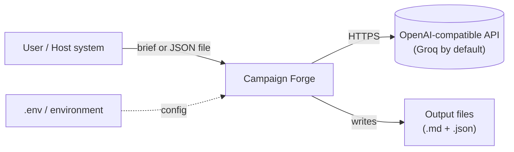

Campaign Forge is a client-side component. Its only external dependency at
runtime is an OpenAI-compatible chat-completions endpoint. Configuration and
secrets arrive through the environment; output is written to the local
filesystem (or consumed directly when used as a library).

## 4. Component architecture

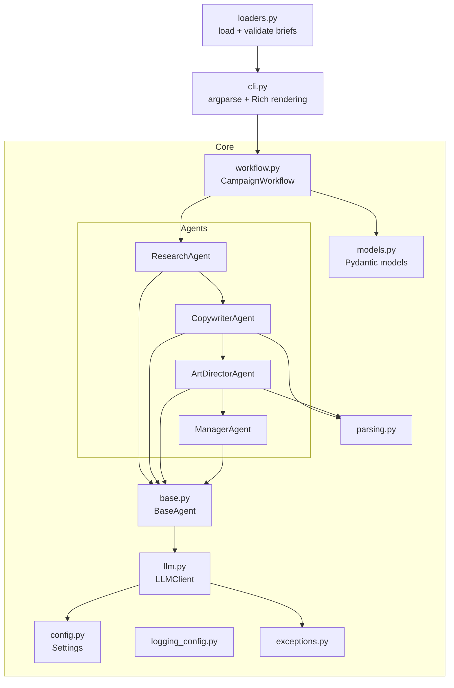

### Component responsibilities

| Component | Responsibility | Key collaborators |
| --- | --- | --- |
| `cli.py` | Parse arguments, resolve settings, render results, map errors to exit codes. | `workflow`, `loaders`, `models` |
| `config.py` | Load and validate settings from env / `.env`; resolve the API key lazily. | `pydantic-settings` |
| `models.py` | Define and validate `CampaignBrief`, `CopyContent`, `CampaignResult`. | `pydantic` |
| `llm.py` | Single chat-completion call with retries, backoff, timeout, and logging. | `openai`, `tenacity`, `config` |
| `agents/base.py` | Shared agent contract: identity, LLM access, prompt dispatch. | `llm` |
| `agents/*` | One pipeline stage each: prompt construction and output parsing. | `base`, `parsing`, `models` |
| `parsing.py` | Recover JSON objects and prompt lists from imperfect model text. | (none) |
| `workflow.py` | Sequence agents for one brief; run many briefs concurrently. | `agents`, `models` |
| `loaders.py` | Read and validate briefs from a JSON file. | `models` |
| `logging_config.py` | Configure a Rich handler on the package logger (stderr). | `rich` |
| `exceptions.py` | Typed exception hierarchy for precise error handling. | (none) |

## 5. Runtime flow

### Single campaign

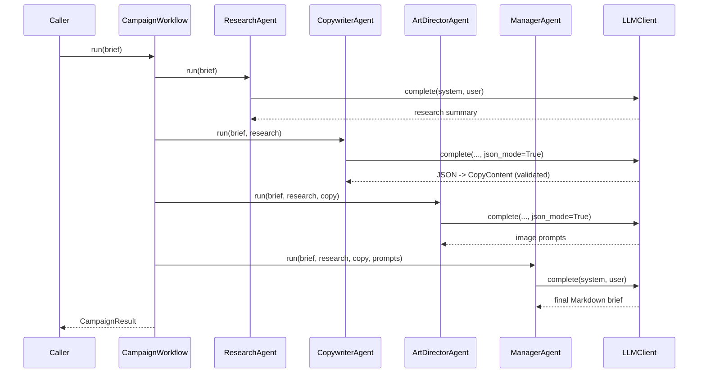

The stages are strictly sequential because each depends on the previous stage's
output. A single campaign therefore makes four model calls.

### Batch

`run_batch()` submits each brief to a `ThreadPoolExecutor`. Threads (not
processes or async) are the right tool here because the work is I/O-bound:
almost all wall-clock time is spent waiting on the network. Each task is wrapped
so that any exception is captured on the result object rather than raised,
guaranteeing that one failure cannot abort the batch. Results are collected as
they complete and then re-sorted into input order.

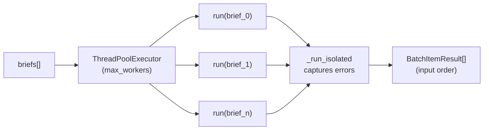

## 6. Data model

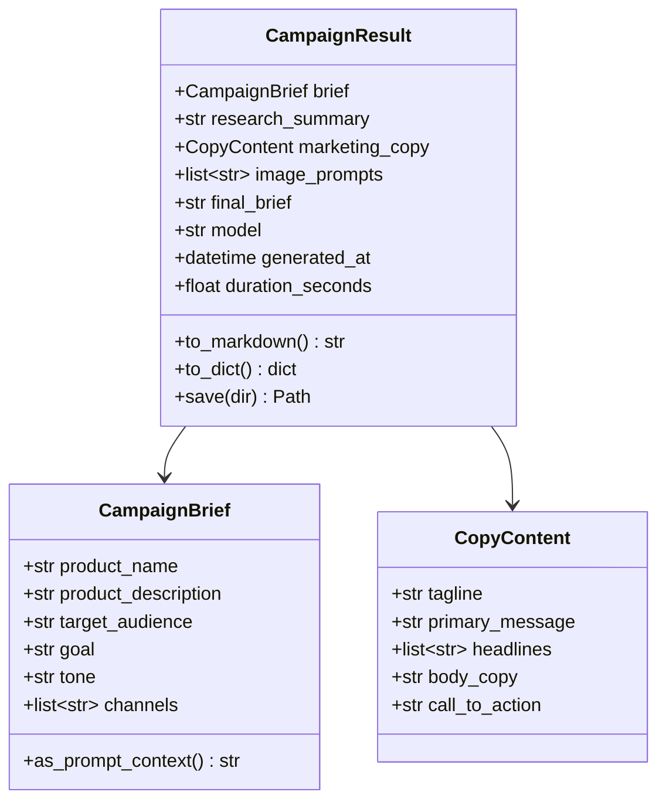

`CampaignBrief` is immutable (frozen) and forbids unknown fields, so it is a safe
contract to pass around. Every field is length-bounded and the channel list is
capped in count and per-item length, so a pathological brief cannot balloon
prompt size or cost. `CopyContent` coerces common model quirks (for example, a
single headline string becomes a one-element list) while still rejecting
genuinely incomplete output.

## 7. Concurrency and scaling

- **Statelessness.** The pipeline holds no mutable shared state between briefs,
  so horizontal scaling is trivial: run more workers, or more processes/hosts.
- **Thread safety.** The `openai` sync client is safe to share across threads. A
  fresh `tenacity` retry controller is created per request, so no retry state is
  shared between concurrent calls.
- **Backpressure.** `max_workers` bounds concurrency. Combined with rate-limit
  backoff, this keeps the system within provider quotas.
- **Throughput ceiling.** For a single provider account the practical limit is
  the provider's tokens-per-minute quota, not CPU. Raising throughput means a
  higher tier, multiple accounts, or a smaller `CF_MAX_TOKENS`.

## 8. Resilience and error handling

The exception hierarchy lets callers catch broadly or precisely:

```text
CampaignForgeError
  |-- ConfigurationError      (missing/invalid settings; fail fast)
  |-- LLMError                (transport failure after retries)
  +-- AgentError
        +-- OutputParsingError  (model output could not be parsed/validated)
```

Resilience is centralised in `LLMClient`:

- **Retries** apply only to transient errors: rate limits, timeouts, connection
  errors, and 5xx. Permanent errors (authentication, bad request) fail fast.
- **Backoff** is exponential with jitter, and honours a server `Retry-After`
  hint (header or message) when present, capped by a maximum delay.
- **Timeout** bounds every request.
- **Empty responses** are treated as failures rather than returned as empty
  strings.
- **Truncated responses** - a completion cut off at the token limit
  (`finish_reason == "length"`) - are treated as failures too, so a partial,
  mid-sentence brief is never saved as if it succeeded.

Agents add a second, output-shaped layer of resilience on top of the transport
layer. The copywriter re-asks the model once, with the parse error fed back, when
its first response is not valid `CopyContent`; the art director falls back to
line parsing when the model ignores the JSON request. A single malformed response
therefore rarely fails a whole campaign.

Durability at the write boundary: `CampaignResult.save()` creates its Markdown
file with an exclusive open and appends a numeric suffix on a name clash, so two
results that share a timestamp-second and slug (common in a batch, and universal
for non-Latin names that slugify to a constant fallback) cannot overwrite each
other.

In batch mode, `_run_isolated` converts any exception into a captured error on
the `BatchItemResult`, preserving whole-batch progress.

## 9. Configuration and secrets

- Settings are resolved from constructor arguments, then environment variables,
  then a `.env` file, using `pydantic-settings`.
- The API key is resolved lazily via a property, so importing or constructing
  `Settings` never fails for lack of a key; only an actual model call requires
  one. This keeps the package import-safe for tests and tooling.
- `get_settings()` returns a process-wide cached instance; the CLI derives a
  per-invocation copy with command-line overrides applied.

## 10. Observability

Logging uses a dedicated `campaign_forge` logger namespace with a Rich handler
that writes to **stderr**, keeping stdout clean for data (notably `--json`
output). The library never configures the root logger, so a host application's
logging is untouched until it opts in. Log level is configurable
(`CF_LOG_LEVEL` or `--verbose`).

## 11. Extensibility

- **Add an agent.** Subclass `BaseAgent`, set `name` and `system_prompt`,
  implement `run(...)`, and wire it into `CampaignWorkflow`. The base class
  enforces the contract at class-creation time.
- **Swap the model or provider.** Change `CF_MODEL` and `CF_BASE_URL`. Any
  OpenAI-compatible endpoint works; no code change is required.
- **Change output format.** Extend `CampaignResult` (for example, add a
  `to_html()` or PDF exporter) without touching the agents.

## 12. Testing strategy

The suite is fully offline. A `FakeLLM` that duck-types `LLMClient` returns
deterministic, agent-specific responses, so tests exercise real orchestration
without any network access or API key. Coverage spans:

- model validation and serialisation,
- retry/backoff behaviour and error wrapping (with sleep patched out),
- batch ordering and per-item error isolation,
- lenient parsing of imperfect model output,
- CLI behaviour, exit codes, and stdout/stderr separation.

The mocked suite proves the plumbing but cannot judge real-model quality. A
separate **evaluation harness** (`evals/`) fills that gap: it runs a diverse,
deliberately adversarial brief corpus (non-Latin and emoji text, oversized input,
long channel lists, a prompt-injection attempt, minimal and ambiguous briefs)
end-to-end and scores each result on completion, grounding, substance, and
injection resistance. It runs offline against a deterministic fake model (a
key-free CI smoke test) or against a live provider, and exits non-zero below a
configurable pass-rate gate.

## 13. Packaging and deployment

- Standard `src/` layout, built with setuptools; the version is single-sourced
  from `campaign_forge.__version__`.
- Installs a `campaign-forge` console entry point; also runnable as
  `python -m campaign_forge`.
- Ships `py.typed` so downstream type-checkers see the annotations.
- CI validates lint, formatting, strict typing, and tests on Python 3.10-3.13.

## 14. Trade-offs and non-goals

- **Sequential per campaign.** The four stages are dependent, so they cannot be
  parallelised within a single campaign; parallelism is across campaigns.
- **Synchronous client.** A sync client with threads is simpler and sufficient
  for I/O-bound batch work; an async client is listed as future work for very
  high fan-out.
- **No persistence or scheduling.** Storage, queuing, and retries-across-restart
  are intentionally left to the host system.

## 15. Future scaling directions

- Async LLM client for higher concurrency at lower thread overhead.
- Pluggable pipeline definition (declarative stages) to support alternative
  workflows without code changes.
- Caching of intermediate results keyed by brief hash to avoid recomputation.
- Optional metrics/tracing hooks for production observability.

---

# Part II - Target architecture: Campaign Forge 2.0 (in progress)

> Status: designed in Session 0; Sessions 1 and 2 implemented (2026-11-10).
> ADR numbers refer to [DECISIONS.md](DECISIONS.md). Session numbers refer to
> [ROADMAP.md](ROADMAP.md).

**Implementation status**

| Component (section) | Status | Package |
| --- | --- | --- |
| Domain: artifacts, claims, evidence, usage, scope (T4) | **Implemented** (S1) | `campaign_forge.domain` |
| `AgentSpec`, `Agent` protocol, `AgentRegistry` with entry points (T4) | **Implemented** (S1) | `campaign_forge.core` |
| `Budget`, events, `RunContext`, cancellation token (T5, T12) | **Implemented** (S1) | `campaign_forge.core` |
| Provider protocol, OpenAI-compatible provider, profiles, `FakeProvider`, router (T7) | **Implemented** (S1) | `campaign_forge.providers` |
| Untrusted-content framing, secret redaction, architecture test (T11) | **Implemented** (S1) | `campaign_forge.security`, `tests/security/` |
| Workflow definitions, engine, run state machine, run stores, planners (T5, T6) | **Implemented** (S2) | `campaign_forge.orchestration` |
| v1 `CampaignWorkflow` on the engine (`classic-campaign`, `legacy.*` agents) (T14) | **Implemented** (S2) | `campaign_forge.workflow`, `campaign_forge.agents.legacy` |
| CLI: `agents`, `workflows`, `execute`, `runs` (T10) | **Implemented** (S2) | `campaign_forge.cli_runs` |
| Agent library, wave 1: 11 agents (`docs/AGENT_CATALOG.md`) | **Implemented** (S3) | `campaign_forge.agents.library`, `campaign_forge.agents.schemas` |
| Deterministic checks, rubrics, offline responder | **Implemented** (S3) | `campaign_forge.evaluation` |
| Tools and evidence-backed research (T8): search tools, safe fetcher, user sources, citations, `competitor_research`, `fact_checker` | **Implemented** (S4) | `campaign_forge.tools`, `campaign_forge.agents.library.evidence` |
| Brand agents (`brand_strategist`, `brand_consistency`), `brand-kit`, optional brand input | **Implemented** (S5) | `campaign_forge.agents.library.brand`, `campaign_forge.domain.brand` |
| Memory and persistence (T9): scoped SQLite memory (FTS5, LIKE fallback), redaction, SQLite run store, campaign history; Postgres deferred (ADR-031) | **Implemented** (S5) | `campaign_forge.memory`, `campaign_forge.orchestration.store`, `campaign_forge.orchestration.history` |
| Agent library, wave 2 (remaining) | Planned (S8) | - |
| Streamlit app, FastAPI (T10) | Planned (S6, S7) | - |

Implementation notes on T5 and T6 (Session 2). These are decisions the design left open; see ADR-022.

- **`after` versus inputs.** `after` is ordering only: a step waits until the named steps finish, whatever their outcome. An input binding is a data dependency. A required input whose source did not succeed skips the step (`skip_reason = dependency`). An optional input from such a source is simply left out.
- **Call accounting.** `llm_calls` counts every admitted call, including one the provider then refuses (for example, for quota).
- **Review.** A step whose review score is still below the threshold after `max_revisions` is accepted with a note. It is not failed. The score is kept on the step.
- **Pausing.** A quota or rate-limit error that was not retried pauses the run, as does exhausting the budget. The affected step returns to pending, every finished step stays done, and `resume()` gets a fresh budget.
- **Extra recovery transitions.** Beyond the T6 diagram, `FAILED -> RUNNING` (retry) and `FAILED -> CANCELLED` (abandon) are allowed.
- **Timeouts.** A step that exceeds its timeout is abandoned. Its cancel token is set, so its thread stops at the next model call, and the step fails with `StepTimeoutError`.

Implementation note on T4: an `Artifact` stores its payload as JSON data
(`data: dict`), not as a live model instance. `Artifact.from_model()` and
`Artifact.as_model(cls)` convert to and from the typed Pydantic model. Artifacts
therefore serialise into checkpoints and API responses with no registry lookup.

## T1. Goals and non-goals

**Goals**

- Replace the fixed four-step chain with an engine that runs **declarative workflows**
  over a **registry of specialised agents**. A campaign, an SEO content pack, an email
  sequence or a performance review then becomes data, not new orchestrator code.
- Keep every v1.1 guarantee: typed boundaries, transient-only retries, fail-loud
  truncation, an offline test suite, an embeddable library and a dependency-light core.
- Run entirely on free tiers ([FREE_TIER_POLICY.md](FREE_TIER_POLICY.md)), and fall back
  to a deterministic, clearly labeled demo mode when no provider is available.
- Make provenance explicit. Every factual claim is labeled as user-provided, external
  (with a citation to evidence a tool actually retrieved), a model assumption, or
  derived.
- Be bounded by construction. Every run has hard limits on LLM calls, tokens,
  wall-clock time and revision rounds.

**Non-goals**

- **No acting in the world.** The system does not post to social networks, send email,
  manage ad accounts or spend money; outputs are exports. Any future action of this
  kind requires an explicit human approval gate (see [SECURITY.md](SECURITY.md)).
- **No paid data.** There are no search-volume, traffic or competitor-metric APIs.
  Numbers come only from data the user supplies.
- **No image generation** in the core roadmap; the system produces prompts only.
- **No distributed execution.** The engine runs in a single process; host systems scale
  out by running more processes.
- **No open-ended autonomous loops.** The planner chooses among validated workflow
  options; it cannot create unbounded agent conversations (ADR-002).

## T2. System context and boundaries

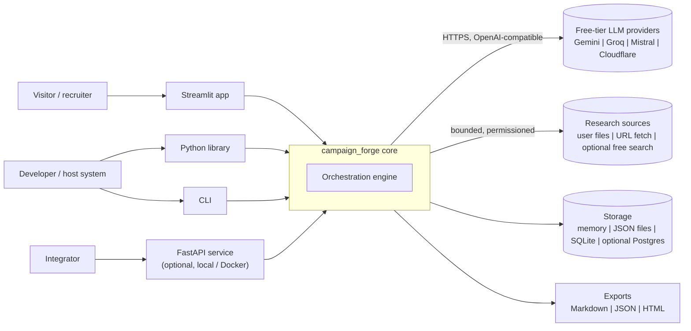

Four entry points share one core, and none of them contains business logic:

| Entry point | Audience | Hosting |
| --- | --- | --- |
| Python library | Developers embedding the engine | Anywhere |
| CLI (`campaign-forge`) | Developers, automation, CI | Local |
| Streamlit app | Public demo, end users | Streamlit Community Cloud (free) |
| FastAPI service | Integrators | Local or Docker; not part of the free public deployment |

The Streamlit app calls the core **in-process**, not through the API (ADR-006). Free
hosts run a single process, and routing through an HTTP API there would add a second
moving part without benefit.

## T3. Layered component architecture

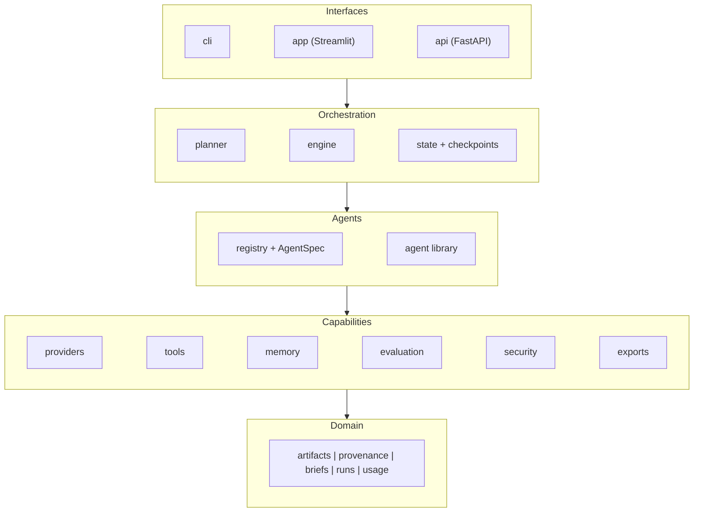

**Dependency rule:** imports point downward only. Providers, tools and memory never
import agents or orchestration, and domain models import nothing internal. An
architecture test (stdlib `ast`, so no new dependency) enforces the rule in CI.

**Target package layout.** This keeps the v1 `src/` layout and public modules (ADR-001):

| Path | Contents | Origin |
| --- | --- | --- |
| `campaign_forge/models.py`, `workflow.py`, `llm.py`, `cli.py` | v1 public API, kept as compatibility facades | v1 |
| `campaign_forge/domain/` | `Artifact`, `Claim`, `Provenance`, `Evidence`, `Usage`, run and step records | new |
| `campaign_forge/core/` | `AgentSpec`, `Agent` protocol, `AgentRegistry` (+ entry-point discovery), `RunContext`, `Budget`, events | new |
| `campaign_forge/orchestration/` | `WorkflowDefinition`, built-in templates, planner, engine, state machine, checkpoint stores | new |
| `campaign_forge/providers/` | `Provider` protocol, `OpenAICompatibleProvider`, vendor profiles, `FakeProvider`, router | refactor of `llm.py` |
| `campaign_forge/agents/<category>/` | Agent library (research, strategy, content, seo, creative, analytics, quality) | v1 agents migrated |
| `campaign_forge/tools/` | Tool protocol, user sources, URL fetch, optional search adapters | new |
| `campaign_forge/memory/` | Scoped repositories (runs, brands, campaigns), retrieval | new |
| `campaign_forge/evaluation/` | Deterministic rubric checks shared by the Critic and the eval harness | new |
| `campaign_forge/security/` | Untrusted-content framing, secret redaction, demo quotas, URL safety | new |
| `campaign_forge/exports/` | Markdown, JSON and HTML renderers (v1 `save()` logic moves here) | v1 + new |
| `campaign_forge/api/` | FastAPI app (`[api]` extra) | new |
| `app/` | Streamlit app (`[ui]` extra) | new |

## T4. Core concepts

**Brief.** The v1 `CampaignBrief` is unchanged. Optional context (brand profile
reference, budget, constraints, user-supplied sources) lives in a separate
`BriefContext`, so the v1 contract stays stable.

**Artifact.** Artifacts are the only thing agents exchange (ADR-004):

| Field | Meaning |
| --- | --- |
| `id` | Stable ID within the run |
| `kind` | Namespaced, versioned type, e.g. `research.audience@1`; each kind maps to a Pydantic model |
| `data` | The validated Pydantic payload |
| `claims` | Optional list of `Claim(statement, basis, evidence_ids)` |
| `produced_by` | Agent ID, prompt version, provider, model, fallback flag |
| `usage` | Prompt and completion tokens, latency, retries |
| `created_at` | UTC timestamp |

**Provenance.** `basis` is one of `USER_PROVIDED`, `EXTERNAL_SOURCE`, `STORED_MEMORY`,
`MODEL_ASSUMPTION` or `DERIVED`. Only tools can create `Evidence` records (URL or
document, title, retrieved_at, excerpt, content hash); models never can. A claim with
basis `EXTERNAL_SOURCE` must cite evidence IDs that exist in the run's evidence store.
A citation the model invents therefore fails validation instead of reaching the user.

**AgentSpec.** Each agent declares its contract as data:

| Field | Purpose |
| --- | --- |
| `id`, `name`, `description`, `version`, `category`, `capabilities` | Identity and catalog metadata (Agent Marketplace) |
| `inputs` | Required and optional artifact kinds |
| `output` | Artifact kind and Pydantic model |
| `instructions`, `prompt_version` | System instructions, versioned for eval comparisons |
| `allowed_tools` | Tool allowlist; the engine injects only these tools |
| `provider_preference` | Default provider profile and model class (`small`, `standard`, `strong`) |
| `limits` | `max_tokens`, `max_calls`, `timeout_s`, `max_repairs` |
| `rubric` | Evaluation criteria used by the Critic and the eval harness |

Agents are stateless. The contract is
`run(inputs: Mapping[str, Artifact], ctx: RunContext) -> AgentOutput`, and all state
lives in the run. New agents register through a decorator or through the
`campaign_forge.agents` Python entry-point group, so third-party packages can add
agents without touching the orchestrator.

**WorkflowDefinition.** A versioned, JSON-serialisable DAG. Each step has: `id`;
`agent`; input bindings to upstream artifacts; an optional `when` condition (a
declarative predicate, never `eval`); an optional `review` block (critic, rubric,
threshold, `max_revisions`); an optional `approval` flag; a retry policy; and limits.
Built-in templates are written in Python, and user-built workflows are stored as JSON
(ADR-015).

## T5. Orchestration engine

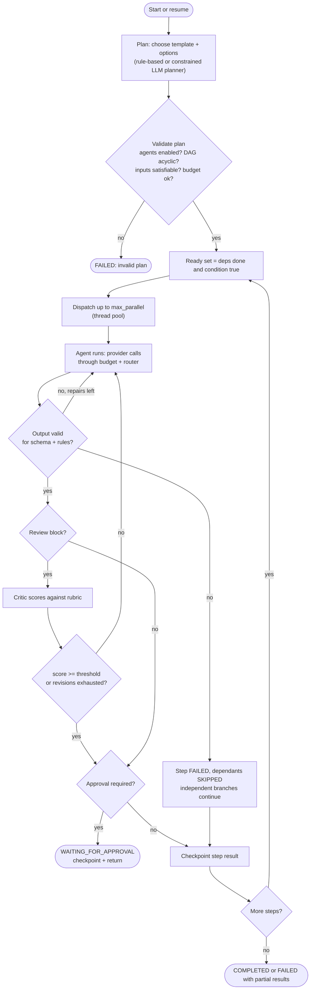

Engine rules:

1. **Planning is constrained.** The rule-based planner is deterministic and works
   offline. The optional LLM planner returns a structured `PlanProposal` that may only
   choose a registered template, toggle its optional steps and set declared
   parameters. The engine validates the proposal against the registry, and a rejected
   proposal falls back to the default template. The plan is shown to the user and can
   be an approval gate itself.
2. **Parallelism only for independent steps.** Ready steps run concurrently, up to
   `max_parallel`.
3. **Bounded everything.** A thread-safe `Budget` meters LLM calls, tokens, wall-clock
   time, revisions and repairs per run. Exceeding a limit stops new work and pauses
   or fails the run with a clear reason; it never silently truncates output.
4. **Failure isolation.** A failed step blocks only its dependants. The run keeps the
   completed artifacts as partial results.
5. **Quota exhaustion pauses the run.** When the provider reports exhaustion and no
   fallback is explicitly enabled, the run moves to `PAUSED` with
   `reason=QUOTA_EXHAUSTED` and a `resume_after` hint. The checkpoint is kept.
6. **Cooperative cancellation.** A cancellation token is checked before each step and
   each provider call; in-flight HTTP requests are bounded by the request timeout.
7. **Idempotent resume.** Step results are keyed by step ID plus an input fingerprint.
   On resume, completed steps are reused and nothing expensive repeats unless the user
   asks to re-run it.

Default limits (tuned in Session 2; the public demo uses stricter values):

| Limit | Default |
| --- | --- |
| LLM calls per run | 40 |
| Total tokens per run | 60,000 |
| Wall-clock per run | 600 s |
| Parallel steps | 3 |
| Revisions per reviewed step | 1 |
| Repair attempts per step | 1 |

## T6. Run lifecycle

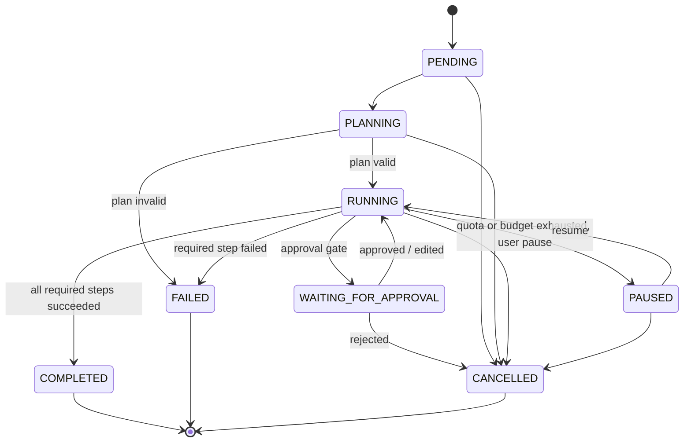

Step states: `PENDING`, `READY`, `RUNNING`, `SUCCEEDED`, `FAILED`, `SKIPPED`,
`WAITING_FOR_APPROVAL`, `CANCELLED`.

A **run** (the "execution session" of the master prompt) records: run ID; scope
(`org_id`, `user_id`); campaign ID; workflow ID and version; status and current stage;
step states with assigned agents and dependencies; artifacts; the event history;
errors; usage totals against limits; and timestamps. Run records and checkpoints go to
whichever `RunStore` is configured: in-memory, JSON file, SQLite or Postgres.

## T7. Provider architecture

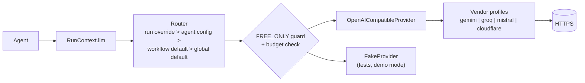

- **One protocol.** `complete()`, `complete_structured(schema)` (JSON mode, parse,
  validate, bounded repair), `health_check()` and `model_info()`.
- **One implementation plus profiles** (ADR-003). The v1 `LLMClient` becomes the core
  of the `OpenAICompatibleProvider`. A profile holds a vendor's base URL, the name of
  its key variable, model aliases (`small`, `standard`, `strong`), its JSON-mode
  support level, its rate-limit message patterns and its free-tier eligibility. A
  native SDK is added only when a required feature is missing from a vendor's
  OpenAI-compatible endpoint.
- **Normalised errors.**
  - `RateLimited(retry_after)` is retried, with bounded attempts.
  - `QuotaExhausted` (daily or monthly limit) is not retried; the run pauses, or uses
    a fallback if one is explicitly enabled.
  - `AuthError` and `BadRequest` fail fast.
  - `Timeout` and `Unavailable` are retried, with bounded attempts.
  - `Truncated` and `ContentFiltered` fail the step with an actionable message.
- **No silent substitution.** A fallback provider is used only when it is listed in
  configuration. The artifact records the provider and model that actually ran, and
  the UI flags fallback use.
- **Usage capture.** Every response's `usage` block is recorded per call, step and
  run. On free tiers the cost is reported as `$0`. An optional list-price table can
  show an "equivalent cost", labeled as an estimate.

## T8. Tools and evidence-backed research

Research uses an engine-driven **plan, retrieve, synthesise** pattern instead of native
function calling (ADR-005). Function-calling support differs across free-tier models,
and the engine-driven loop is easier to bound and test.

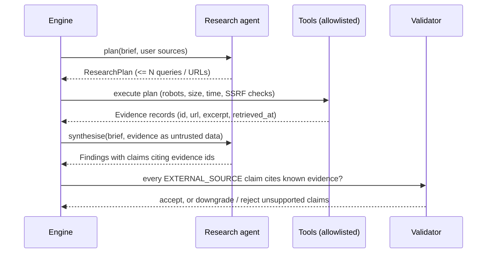

If no research tool is configured, or every retrieval fails, the agent runs in
**assumptions mode**. Every claim is then labeled `MODEL_ASSUMPTION`, and the artifact
states that external research was unavailable.

Tool safety rules (detailed in [SECURITY.md](SECURITY.md)):

- Tools are allowlisted per agent.
- Network tools accept only `http(s)` URLs, refuse private, loopback and link-local
  addresses, and honour `robots.txt`.
- Size, time and content-type caps apply to every fetch.
- No cookies, credentials or JavaScript execution, and no attempt to get around
  CAPTCHAs or access controls.
- Tools never execute code.

## T9. Memory and persistence

Every repository method requires a `Scope(org_id, user_id)`. There is no unscoped
query path.

| Store | Contents | Backends | Session |
| --- | --- | --- | --- |
| `RunStore` | Run records, checkpoints, events | in-memory, JSON file | S2 |
| `RunStore` | (same) | SQLite | S5 |
| `BrandStore` | Brand profiles, guidelines, products, audiences, tone | SQLite; optional Postgres (Supabase) | S5 |
| `CampaignStore` | Campaign history and artifacts | SQLite; optional Postgres (Supabase) | S5 |
| Retrieval | Full-text search over stored knowledge (SQLite FTS5 / Postgres full-text) | same as above | S5 |
| Embeddings | Optional semantic search | free local models only, never required | later |

Rules:

- Retrieved memory enters prompts as delimited, labeled data (`STORED_MEMORY`), never
  as instructions.
- A user can delete everything stored under their scope.
- Secrets are never written to memory.
- The public demo stores no visitor data on the server; its state lives only in the
  session (ADR-008).

## T10. Interfaces

- **CLI.** The v1 `run` and `batch` subcommands keep their flags and exit codes. New
  subcommands (exact names are settled in Session 2):
  - `agents list` and `agents show`
  - `workflows list`, `workflows show` and `workflows validate`
  - `execute <workflow>`
  - `runs show`, `runs resume`, `runs approve` and `runs cancel`
- **Streamlit app.** Navigation covers every studio requested in the master prompt.
  The studios are workflow templates rendered by shared views, so the 16 navigation
  entries map onto about 9 underlying views (ADR-018). Users can inspect each step's
  inputs, output, evidence, usage and errors. Private chain-of-thought is never shown.
- **FastAPI.** The `/api/v1` endpoints from the master prompt, with typed request and
  response models. Runs execute in background threads inside one process (single
  node). API-key authentication and request limits apply.
- **Settings.** Every long-lived entry point builds `Settings` explicitly, per session
  or request. The cached `get_settings()` remains only for CLI compatibility (fixes
  D2).

## T11. Security

See [SECURITY.md](SECURITY.md) for the threat model and controls. The architectural
points are:

- **Untrusted text is framed as data.** This covers briefs, user files, fetched pages
  and stored memory.
- **Tools are permissioned per agent.**
- **No generated code is ever executed.**
- **Secrets are redacted** in logs and error messages.
- **Every run is bounded by a budget.**
- **The public demo has caps** per session and per day.

## T12. Observability

- **Structured logs** carry `run_id` and `step_id` through context variables, and pass
  through a secret-redaction filter.
- **A typed event stream** (`RunStarted`, `StepStarted`, `StepFinished`,
  `UsageRecorded`, `ApprovalRequested`, and so on) feeds the CLI progress display, the
  Streamlit run inspector, the API status endpoint and the run history.
- **Usage metering** records provider, model, tokens, latency and retries per call.
- **OpenTelemetry** is an optional extra added later. The events are designed to map
  onto spans. No paid monitoring is involved.

## T13. Deployment architecture

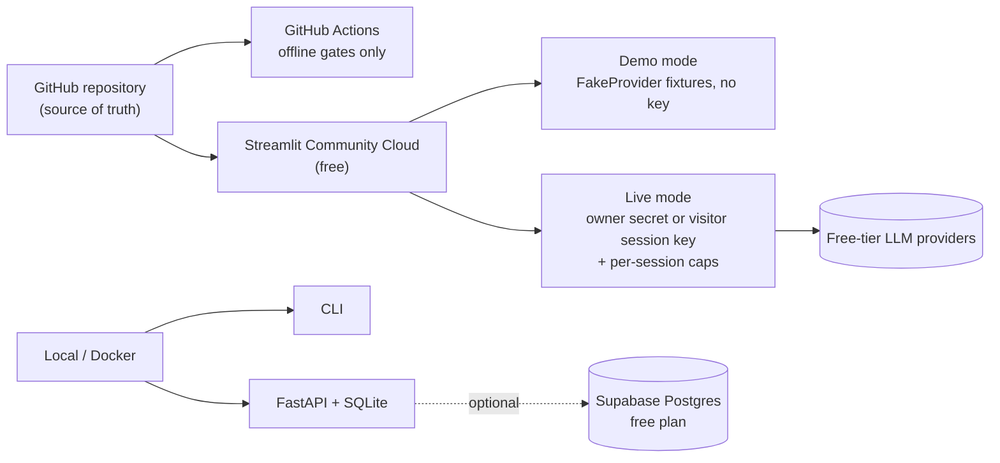

Hosting constraints, verified in Session 0, are recorded in
[FREE_TIER_POLICY.md](FREE_TIER_POLICY.md). The design follows from them:

- The public app is **stateless and recoverable**.
- **Demo mode is the default.**
- **Live runs execute step by step**, with checkpoints in session state.
- **No background worker** is assumed to exist.

## T14. Backward compatibility and migration

- The v1 public API stays available:
  - classes: `CampaignWorkflow`, `CampaignBrief`, `CampaignResult`, `CopyContent`,
    `LLMClient`
  - `load_briefs` and the exception classes
  - the CLI `run` and `batch` subcommands with their flags and exit codes
  - the output file format
- In Session 2, `CampaignWorkflow.run()` becomes a facade that runs the built-in
  `classic-campaign` template on the engine and maps the artifacts back to a
  `CampaignResult`.
- The 82 v1 tests are the regression suite. They may change only intentionally, with
  the reason recorded in [SESSION_LOG.md](SESSION_LOG.md). Objects shaped like
  `LLMClient` (including the test `FakeLLM`) keep working through a provider adapter.
- Deprecations are announced in `CHANGELOG.md` and removed no earlier than the next
  major version.

## T15. Key risks

| Risk | Impact | Mitigation |
| --- | --- | --- |
| Free-tier quotas are too small for multi-agent runs | Runs pause or fail mid-way | Budgets, per-agent `max_tokens`, small models for simple agents, checkpoint and resume, demo mode as default |
| Free-tier terms change | The policy silently becomes wrong | Provider facts live in profiles (config, not code), re-verification schedule in [FREE_TIER_POLICY.md](FREE_TIER_POLICY.md) |
| Hosting limits (sleep, ephemeral disk, one process) | Lost runs, slow first load | Stateless app, session-state checkpoints, fixtures for the demo |
| Free-tier data-use terms (some providers may use prompts to improve products) | Privacy exposure for visitors | Visible notice, no private data in the public demo, visitor-supplied keys never stored |
| Scope creep (37 agents, 16 pages) | Many shallow features | Consolidated catalog ([AGENT_CATALOG.md](AGENT_CATALOG.md)), delivery waves, acceptance criteria per session |
| Small free models produce variable output | Validation failures | Structured outputs, validation, bounded repair, critic review, live evals |
| Fabricated research | Credibility loss | Evidence-ID citations enforced by a validator; assumptions mode labeled |
| Public demo abuse | Quota drain | Per-session and daily caps, bring-your-own-key option, demo mode default |
