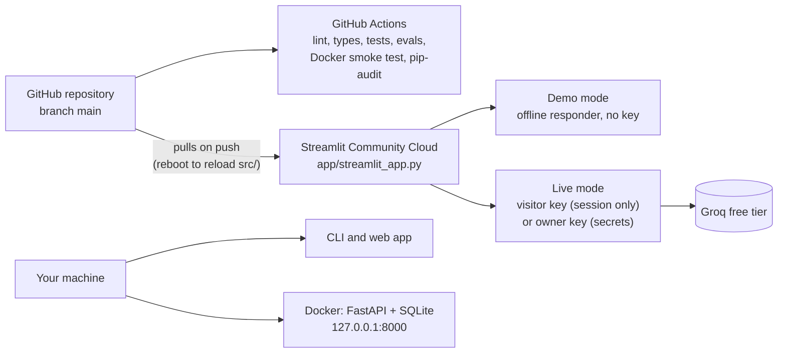

# Deployment

Campaign Forge runs in three places. Each runs on free tiers only.

| Target | What runs | Status |
| --- | --- | --- |
| **Streamlit Community Cloud** | The web app: demo mode, plus live mode on a visitor's or the owner's Groq key | **Deployed** at https://campaign-forge.streamlit.app/. Smoke-tested in a browser after every code push (see [BUILD_STATUS.md](BUILD_STATUS.md)). |
| **Your machine** | The CLI, the web app (demo, live or local mode), the evaluation harness | Tested in CI on Python 3.10-3.13 |
| **Docker** | The HTTP API with SQLite on a volume | Image built, started and smoke-tested in CI on every push |

The hosting choices and their limits were checked against each provider's own documentation ([FREE_TIER_POLICY.md](FREE_TIER_POLICY.md), section 4). The architecture is in [ARCHITECTURE.md](ARCHITECTURE.md), section T13.



---

## 1. Streamlit Community Cloud (the public demo)

### First deployment

1. Fork the repository on GitHub, or use your own copy.
2. Sign in at [share.streamlit.io](https://share.streamlit.io/) with GitHub, and choose **Create app**, then **Deploy a public app from GitHub**.
3. Enter:
   - **Repository:** your fork;
   - **Branch:** `main`;
   - **Main file path:** `app/streamlit_app.py`;
   - **App URL:** the subdomain you want.
4. In **Advanced settings**, pick a Python version. The public demo uses 3.13; any of 3.10-3.13 works. Leave **Secrets** empty for a demo-only app.
5. Choose **Deploy**.
   - Streamlit installs `app/requirements.txt`, which sits next to the entry point and lists the core dependencies plus Streamlit.
   - The app imports `campaign_forge` from `src/`, so the package itself is not installed.

**No secret is needed.** The app starts in demo mode:
- every agent is answered by the deterministic offline responder;
- every output is labeled SIMULATED;
- nothing a visitor enters is stored on the server.

Visitors can switch to live mode with their own Groq key.

### Offering live runs on your own key (optional)

In the app's **Settings**, open **Secrets** and add:

```toml
GROQ_API_KEY = "gsk_..."
CF_LIVE_OWNER_KEY = "true"
```

Then reboot the app (see below).

- **Write the values as strings.** At startup Streamlit copies root-level secrets into environment variables, which is where the app's settings are read. It copies only strings, integers and floats, so a TOML `true` (a boolean) would be ignored.
- **Caps** ([SECURITY.md](SECURITY.md), section 5): every live run is capped at 25 model calls, 30,000 tokens and 20 minutes, and at most 2 run at once. Your key also allows 3 runs per visit and 5 per UTC day. Change them with the `CF_LIVE_*` settings, written as strings (for example `CF_LIVE_DAILY_RUNS = "3"`).
- **Isolation.** Live sessions never read your other secrets. A visitor's run cannot reach another provider key, a fallback provider or a routing override.
- **No bill is possible.** Use a free Groq key with no card on file: the worst case is then a used-up daily quota.

To turn visitor keys off, add `CF_LIVE_VISITOR_KEYS = "false"`.

### After every code push: reboot

A push to `main` makes Streamlit pull the new code within a minute or so. **Modules imported from `src/` stay cached in the running process**, so the app keeps running the old package until it restarts.

To reboot: open the app, choose **Manage app** (bottom right), then the menu, then **Reboot app**. Do the same after changing secrets.

Then check, in a browser:
1. The dashboard loads.
2. A simulated run completes in New Run, with a SIMULATED notice, the run graph and downloads.
3. Settings and Health shows the expected mode, and the Live mode section matches your secrets.

### Free-plan limitations

| Limitation | Effect on Campaign Forge | Mitigation |
| --- | --- | --- |
| Public apps only | The app and its source are public | Demo mode stores nothing; live data stays in the visitor's session |
| The app sleeps after about 12 hours without traffic | The first visit after that waits for a cold start | None needed |
| Small, shared CPU and memory | Live runs wait on Groq's rate limits anyway; at most 2 execute at once | `CF_LIVE_CONCURRENT_RUNS` |
| No durable filesystem; runtime files are lost on restart | Runs and brands live in session memory (ADR-008). Live-mode counters reset on restart. | The daily cap and Groq's own free quota bound the owner's spending |
| A reboot or sleep stops background threads | A live run in progress during a reboot is lost | Reboot when no one is mid-run; runs are capped at 20 minutes |
| One process, no second server | The HTTP API cannot run beside the app | Run the API locally or in Docker (section 3) |

---

## 2. Your machine

```bash
git clone https://github.com/syed-waleed-ahmed/Multi-Agent-Workflow.git
cd Multi-Agent-Workflow
python -m venv .venv && source .venv/bin/activate     # Windows: .venv\Scripts\activate
pip install -e ".[ui,api]"
cp .env.example .env                                  # add GROQ_API_KEY for live runs
```

| Command | What you get |
| --- | --- |
| `streamlit run app/streamlit_app.py` | The public demo's behaviour: demo mode, and live mode with a key |
| `CF_UI_MODE=local streamlit run app/streamlit_app.py` | Your configured provider, with runs and memory stored like the CLI's (`CF_RUNS_DIR`, `CF_MEMORY_DB`) |
| `campaign-forge execute full-campaign --brief brief.json` | One workflow from the CLI, checkpointed and resumable |
| `CF_PROVIDER=fake campaign-forge execute full-campaign --brief brief.json` | The same with no key: simulated output, labeled as such |

Local mode is also where live benchmarks run (`campaign-forge bench ...`). The quota is then your own.

---

## 3. The HTTP API in Docker

```bash
CF_API_KEYS=change-me-0123456789 docker compose up --build
curl -H "X-API-Key: change-me-0123456789" http://127.0.0.1:8000/api/v1/system/status
```

- The container runs as a non-root user and has a health check. Runs and memory live in SQLite on the `forge-data` volume.
- Compose publishes the port on `127.0.0.1` only. Put a TLS-terminating reverse proxy in front before exposing it beyond your machine.
- Provider keys come from `.env` when it exists. With `CF_PROVIDER=fake`, the API is key-free and simulated. CI uses that mode for its smoke test.
- Endpoints, errors and limits are in [API.md](API.md). The schema is in [openapi.json](openapi.json).

---

## 4. Secrets checklist

- [ ] `.env` and `.streamlit/secrets.toml` are git-ignored. Never commit either.
- [ ] Use a free-tier key with no card attached. `CF_FREE_ONLY` (on by default) refuses providers that are not free-tier eligible.
- [ ] Keys appear only as "set" or "not set" on the Settings and Health page and in `/api/v1/system/status`.
- [ ] Rotate a key that was ever pasted into an issue, a log or a screenshot.
