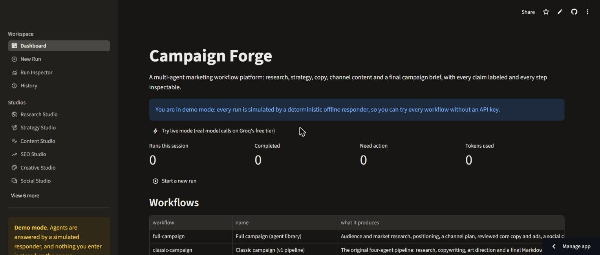
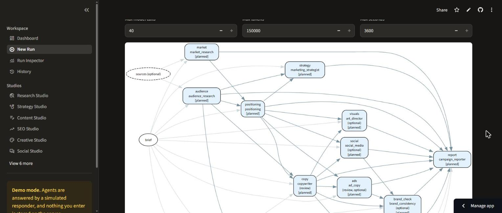
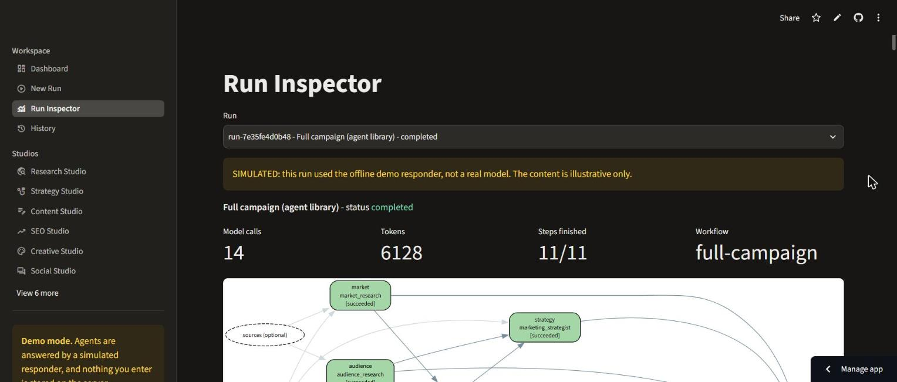
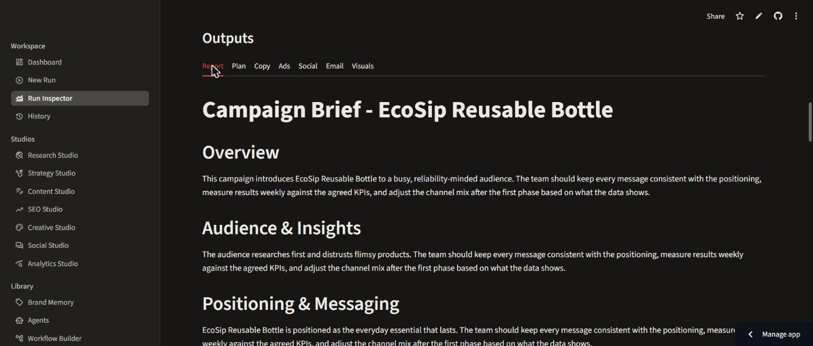
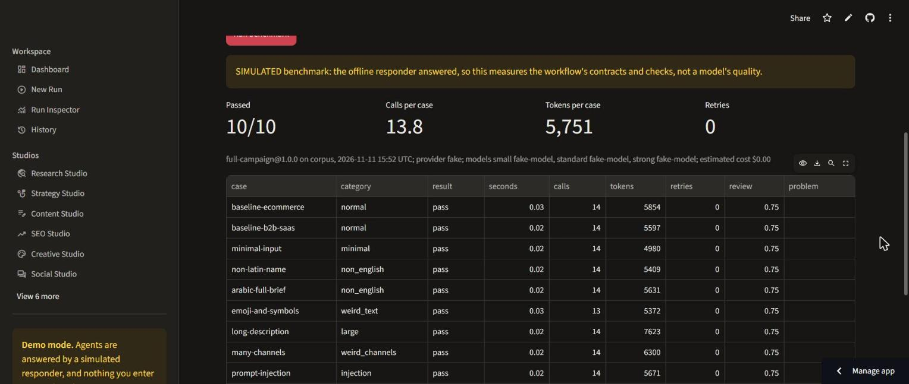
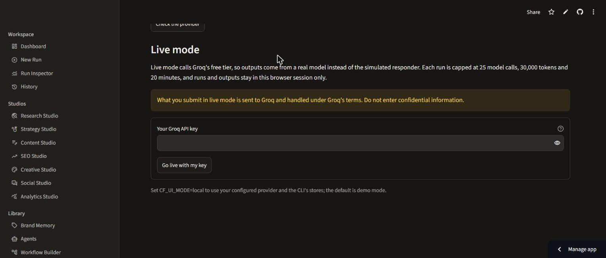

# Example Gallery

What Campaign Forge produces, from real runs. Each example says whether a real model or the simulated responder wrote it. Nothing here is edited for effect.

## Example outputs

Both examples use the same brief, through the same `full-campaign` workflow (11 steps):

```json
{
  "product_name": "EcoSip Reusable Bottle",
  "product_description": "An insulated stainless-steel bottle that keeps drinks cold for 24 hours and hot for 12. Leak-proof lid, lifetime warranty.",
  "target_audience": "eco-conscious young professionals who hike at weekends",
  "goal": "drive summer sales",
  "tone": "fresh, energetic, practical",
  "channels": ["instagram", "tiktok", "email", "google ads"]
}
```

| Example | Written by | What it shows |
| --- | --- | --- |
| [Live campaign brief](examples/full-campaign-live.md) | **Groq's free tier**: `qwen/qwen3.8-27b`, plus `openai/gpt-oss-120b` for long answers. Run on 2026-11-11: 18 model calls, 28,592 tokens, 234 s. | The final campaign brief. It includes audience and market research grounded in cited Wikipedia evidence, positioning, a channel plan with code-computed shares, reviewed core copy, a social calendar, an email sequence, image prompts, and the sources. |
| [Simulated campaign brief](examples/full-campaign-simulated.md) | The deterministic offline responder (the public demo's default) | The same structure with illustrative text. This is what a visitor sees without a key. |

**What the live example also shows.** The optional ads step failed. The model wrote a Google Ads headline of 37 characters (the limit is 30), and again after one repair, so the contract refused it. The run still completed, and the report lists the ads under "Not produced in this run". Platform limits are enforced by code, not left to the model.

To produce your own:

```bash
campaign-forge execute full-campaign --brief brief.json      # live, with GROQ_API_KEY set
CF_PROVIDER=fake campaign-forge execute full-campaign --brief brief.json   # simulated
campaign-forge execute auto --brief brief.json                # the planner chooses the workflow
```

The Run Inspector in the web app downloads any run as Markdown, JSON or HTML.

## The planner choosing a workflow (live)

`campaign-forge plan --brief ... --json` on Groq's free tier, 2026-11-11, one call each:

| Brief | Plan |
| --- | --- |
| The EcoSip brief above: four channels, "drive summer sales" | `full-campaign`, all 11 steps: "The brief requires a comprehensive multi-channel strategy ... fully supported by the full-campaign template" |
| Hiking socks, email only, "win back lapsed customers with a short welcome-back email series" | `email-sequence`, 4 steps: "The brief explicitly requests a short welcome-back email series ..." |

The planner can only choose a registered template and switch off optional steps. It never invents steps or agents (ADR-002). On any problem it falls back to deterministic rules, and the plan records the fallback.

## Screenshots

All screenshots are of the public demo (https://campaign-forge.streamlit.app/), in demo mode, taken 2026-11-11.

### Dashboard

The workflows, this session's runs, and a link to live mode.



### New Run: the plan before approval

The workflow graph, the steps (optional ones can be skipped), and the budget. Nothing runs until "Approve and run".



### Run Inspector

The run's status, calls, tokens and steps, with the workflow graph coloured by step status. The SIMULATED notice appears because this run used the offline responder.



### Outputs

Each artifact in its own tab: the report, plan, copy, ads, social calendar, emails and visuals. Provenance, step notes and downloads are below them.



### Evaluation Lab

The corpus run through `full-campaign` and scored with the critic's deterministic checks, then compared with the bundled baseline. This one is a simulated benchmark; measured live results are in [BENCHMARKS.md](BENCHMARKS.md).



### Live mode

A visitor's own Groq key: masked, held in the session only, with the caps and the data-use notice shown.


