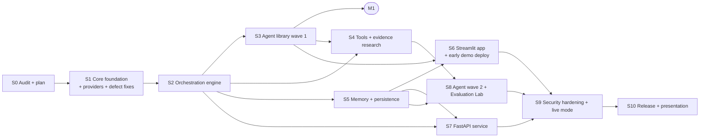

# Roadmap - Campaign Forge 2.0

This roadmap covers the milestones, the sessions in dependency order, and the acceptance
criteria for each session.

- **Granular tasks:** [TASK_BOARD.md](TASK_BOARD.md)
- **Live progress:** [BUILD_STATUS.md](BUILD_STATUS.md)
- **Status:** Sessions 0-3 done (2026-11-10). Milestone M1 is functionally complete. Its live acceptance run (S3-05) waits for the owner's approval to spend free-tier quota.

## 1. Milestones

| Milestone | Sessions | Outcome | Release |
| --- | --- | --- | --- |
| **M1 - Working AI platform** | S1, S2, S3 | Engine, registry, multi-provider layer, budgets, checkpoints and resume, 11 functional wave-1 agents with a critic loop, CLI. The v1 API still works. | `2.0.0a1` after S2, `2.0.0b1` after S3 |
| **M2 - Complete product** | S4, S5, S6, S7, S8 | Evidence-backed research, memory, Streamlit app (demo mode deployed early), FastAPI, wave-2 agents, Evaluation Lab | `2.0.0rc1` after S8 |
| **M3 - Public portfolio** | S9, S10 | Security hardening, live mode, documentation, a smoke-tested public demo | `2.0.0` |

Rule: no wave-2 agents until M1's acceptance criteria are met. Quality and real capability matter more than agent count.

## 2. Session dependency graph

**Size** is a relative estimate:

| Size | Meaning |
| --- | --- |
| S | One sitting |
| M | One full session |
| L | A session that may need a continuation |
| XL | Plan to split across two sittings |

## 3. Sessions

### S0 - Audit and architectural planning (DONE 2026-11-10)

Repository audit; defects reproduced; baseline measured; free-tier facts verified; target
architecture, roadmap, ADRs, agent catalog, security model and progress tracking created.

### S1 - Core foundation, providers, defect fixes (Size: L)

**Goal:** the extensible foundation every later session builds on, with no change to v1 behaviour.

- **Domain:** `Artifact`, `Claim`, `Provenance`, `Evidence`, `Usage`, `Scope`.
- **Core:**
  - `AgentSpec` and the `Agent` protocol
  - `AgentRegistry`, with a decorator and entry-point discovery
  - `RunContext` and a thread-safe `Budget`
  - typed events
- **Providers:**
  - the `Provider` protocol
  - `OpenAICompatibleProvider`, refactored from `llm.py` with usage capture and normalised errors (`RateLimited`, `QuotaExhausted`, ...)
  - profiles for Groq, Gemini, Mistral and Cloudflare
  - `FakeProvider`
  - a router with per-agent configuration, `FREE_ONLY` and explicit fallback
  - `LLMClient` kept as a compatibility facade
- **Security primitives:** untrusted-content framing; a secret-redaction log filter; an architecture test (import direction; no `eval`, `exec` or `subprocess`).
- **Fix defects D1-D5 and D7, plus the D8 per-agent limits.** Each fix gets a regression test.
- **Baseline:** a first live eval run, with the owner's approval, recorded with date and model.

**Acceptance criteria**

- All 82 v1 tests pass unchanged.
- New tests cover every new module.
- Branch coverage is at least 90%.
- `ruff`, `ruff format` and `mypy --strict` pass.
- The offline eval passes, and CI adds Python 3.13.
- A provider contract test suite runs against `FakeProvider` offline. A manual live smoke test against each provider whose key is available is recorded.
- No new runtime dependency other than an explicit `httpx`.

### S2 - Orchestration engine (Size: XL, likely two sittings)

**Goal:** declarative, bounded, resumable multi-agent execution.

- `WorkflowDefinition` (JSON) and its validation: registry membership, acyclic graph, satisfiable inputs, tool allowlists, budget ceilings.
- The engine:
  - ready-set scheduling and parallel independent steps
  - `when` conditions
  - bounded review and repair loops
  - approval gates
  - cooperative cancellation and per-step timeouts
  - run budgets
  - failure isolation with partial results
- The run state machine (section T6 of [ARCHITECTURE.md](ARCHITECTURE.md)), with an event stream.
- Checkpoint stores (in-memory and JSON file); idempotent resume; pausing on quota exhaustion.
- A rule-based planner, plus the optional constrained LLM planner.
- The `classic-campaign` template. `CampaignWorkflow` is rebuilt as a facade over the engine, and `run_batch` uses the engine with incremental saves (fixes D9).
- CLI additions: `agents`, `workflows`, `execute`, `runs show|resume|approve|cancel`.

**Acceptance criteria**

- The v1 tests pass through the facade.
- Each of the following is proven by a test:
  - cycle rejection
  - parallel execution of independent steps
  - exceeding the budget stops the run
  - quota exhaustion pauses, and the resume skips completed steps
  - cancellation
  - the approval-gate round trip
  - partial results after a failed branch
- Coverage is at least 90%.
- Release `2.0.0a1`.

### S3 - Agent library, wave 1 (Size: XL)

**Goal:** 11 genuinely functional agents, the critic loop, and the `full-campaign` template.

- Agents: `audience_research`, `market_research` (labeled assumptions mode), `positioning`, `marketing_strategist`, `copywriter`, `ad_copy`, `social_media`, `email_marketing`, `art_director`, `critic`, `campaign_reporter` (see [AGENT_CATALOG.md](AGENT_CATALOG.md)).
- Templates: `full-campaign`, `ad-pack`, `social-calendar`, `email-sequence`.
- Deterministic rubric checks in `campaign_forge.evaluation`, shared by the critic and the evals.
- The eval harness extended to workflows and agents, with per-agent datasets.
- Fixes D3 and D4 at the agent level.

**Acceptance criteria**

- Every agent meets the catalog's definition of done.
- `full-campaign` completes offline with `FakeProvider`.
- A live `full-campaign` run on the Groq free tier completes within budget, with its measured calls, tokens and duration recorded.
- The critic revision loop is shown by a test.
- **Milestone M1 complete; release `2.0.0b1`.**

### S4 - Tools and evidence-backed research (Size: L)

- The tool protocol, a permission model and the evidence store.
- Sources:
  - user-supplied sources (text, Markdown, CSV, JSON)
  - a safe URL fetcher (SSRF guard, `robots.txt`, size, time and type caps)
  - a Wikipedia adapter with a policy-compliant User-Agent
  - an optional Tavily adapter
- Research agents use the plan, retrieve, synthesise pattern with citation validation.
- New agents: `competitor_research`, `fact_checker`.
- New template: `competitor-report`.

**Acceptance criteria**

- An invented citation is rejected (test).
- Private, loopback and metadata URLs are refused (tests).
- With no sources, the agents switch to assumptions mode and label it.
- The tool code passes security tests.

### S5 - Memory and persistence (Size: L)

- Scoped repositories: runs, brands, campaigns.
- A SQLite backend, with the choice between stdlib and SQLAlchemy recorded as an ADR.
- Full-text retrieval.
- Deleting all data for a scope.
- Optional Supabase Postgres (`[db]`).
- New agents: `brand_strategist`, `brand_consistency`.
- New template: `brand-kit`.

**Acceptance criteria**

- Tenant isolation tests pass.
- Deletion is verified.
- Retrieved memory is framed as data.
- Secrets never reach storage (test).
- Postgres tests run only when a database is available, and are skipped otherwise.

### S6 - Streamlit application and early demo deployment (Size: XL)

- The app shell with the navigation from ADR-018:
  - New Run, with plan preview and approval
  - Run Inspector, with a Graphviz DAG, step status, artifacts, evidence, usage and errors
  - History (session), Brand Memory, Agents and Workflow Builder
  - Settings and Health
- Demo mode with recorded fixtures, labeled SIMULATED.
- Downloads (Markdown, JSON, HTML).
- Deploy demo mode to Streamlit Community Cloud **now**, not in S10.

**Acceptance criteria**

- The app starts locally with no keys.
- A demo run completes and its results download.
- The deployed demo URL works, as smoke-tested and recorded.
- No chain-of-thought is shown anywhere.

### S7 - FastAPI service and developer experience (Size: M)

- The `/api/v1` endpoints from the master prompt, with typed models.
- Background execution in-process.
- API-key authentication and request limits.
- A Dockerfile and `docker compose` for the API with SQLite.
- Examples.

**Acceptance criteria**

- API tests use `TestClient`.
- `/health` passes in Docker.
- The OpenAPI schema is published in the docs.
- No business logic lives in the API layer (architecture test).

### S8 - Agent library wave 2 and Evaluation Lab (Size: XL)

- The remaining catalog agents: SEO, blog, landing page, product description, repurposing, funnel, growth, performance analyst, experiment designer, CRO and safety reviewer.
- The remaining templates.
- Evaluation Lab: datasets, regression baselines, benchmark scenarios, comparison reports (success rate, duration, calls, tokens, retries, scores), and an injection dataset.

**Acceptance criteria**

- Every agent meets the definition of done.
- Benchmarks are produced only by real runs, each recorded with date, provider and model.
- Release `2.0.0rc1`.

### S9 - Security hardening and live mode (Size: L)

- The demo controls in [SECURITY.md](SECURITY.md): per-session and daily caps, concurrency limits, visitor keys held in session only, and safe error messages.
- `pip-audit` in CI.
- Completion of the injection test suite.
- Optional OpenTelemetry.

**Acceptance criteria**

- All security tests pass.
- Caps are enforced (tests).
- No secret appears in logs (test).
- The live mode works on the deployed app with the owner's key, within the caps.

### S10 - Release and GitHub presentation (Size: M)

- A README with the 20 required sections and Mermaid diagrams.
- Screenshots and an example gallery.
- Issue templates, `CODE_OF_CONDUCT.md`, a root `SECURITY.md` and an updated `CONTRIBUTING.md`.
- Deployment documentation.
- A final live smoke test.
- Release `2.0.0`.

**Acceptance criteria**

- The master prompt's definition of done, sections A-E, is met. Any gap is listed explicitly with its blocker.
- No fictional metrics.

## 4. Changes from the master prompt's session plan

| Change | Why | ADR |
| --- | --- | --- |
| Tools and research become S4; memory becomes S5 | Evidence-backed research is the biggest credibility gap, and it is what wave-1 research agents need next | 013 |
| Security primitives move into S1; evaluation is part of every agent session | Retrofitting security and evals at the end is costly and risky | 013 |
| Demo deployed in S6, not first in S10 | Surfaces hosting constraints early | 013 |
| 28 agents instead of 37 classes; 11 in wave 1 | Removes overlap, and forbids empty or duplicate agents | 012 |
| 16 navigation entries backed by about 9 shared views | Same user experience, less duplicated code | 018 |
| Groq as the public live default instead of Gemini | Gemini free-tier terms (data use, EEA/CH/UK restriction) | 019 |

## 5. Explicitly out of scope

- Publishing, sending, ad-account management, payments.
- Paid data sources.
- Image generation.
- Multi-node execution.
- User account systems beyond API keys and session scope.
